# MODE — Student Organization System

[](https://github.com/nitishssh/MODE/actions/workflows/ci.yml)
[](https://github.com/nitishssh/MODE/releases/latest)

One calm workspace for a student club: memberships and dues, event tickets with door check-in, announcements, merchandise, volunteer tasks, and club finances with receipt-backed reimbursements. One person can belong to several clubs and switch between them.

**🎬 [Watch the demo video](https://drive.google.com/drive/folders/1LAnTXMWYU4UIek7Oo2Egs73zMjsNzxPr?usp=drive_link)** · [Latest release](https://github.com/nitishssh/MODE/releases/latest) · [Phase 2 board](https://github.com/users/nitishssh/projects/15)

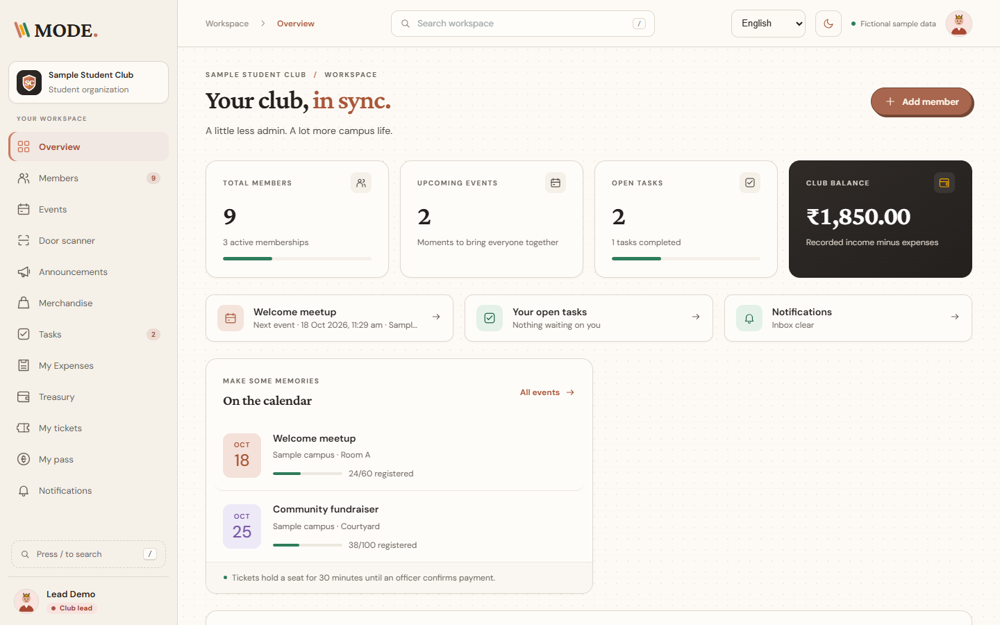

## Screenshots

| Landing | Sign-in with demo accounts |
|---|---|
| 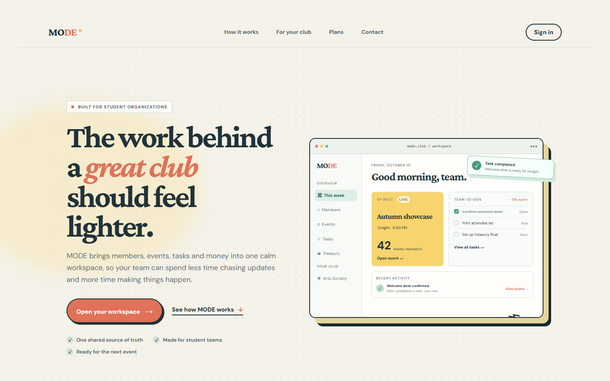 | 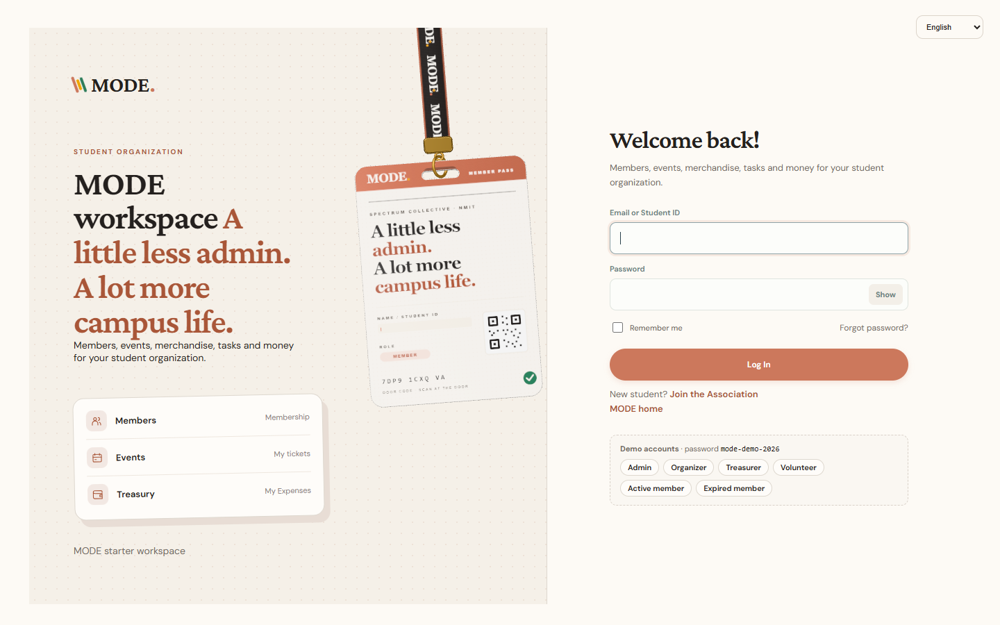 |
| **Member pass (door QR)** | **Events and tickets** |
| 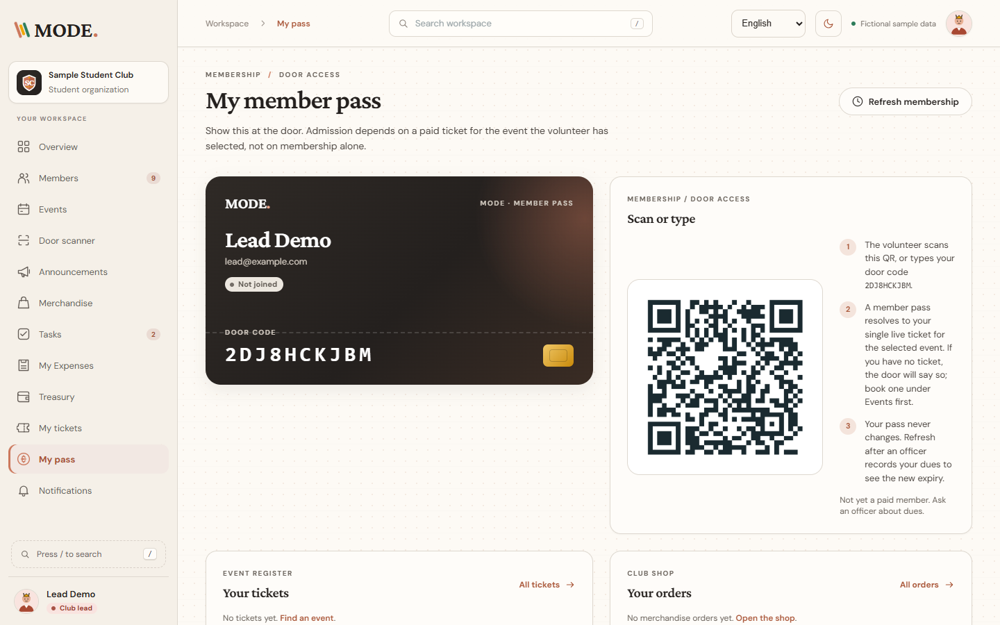 | 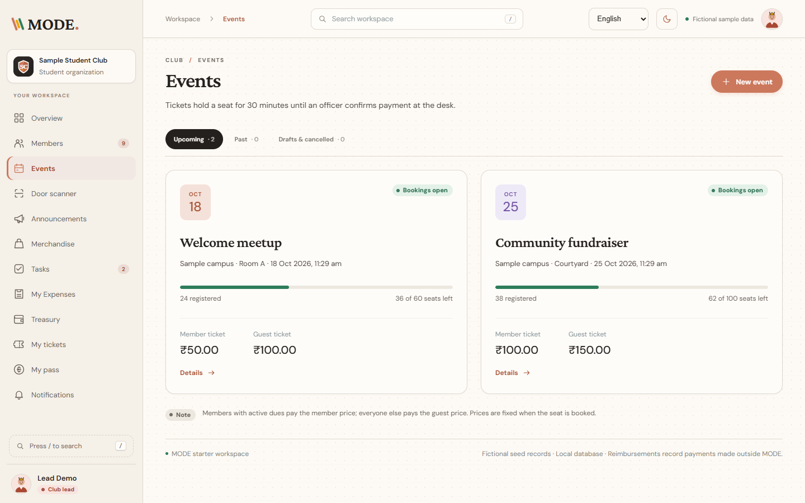 |
| **Merchandise shop** | **Volunteer tasks** |
| 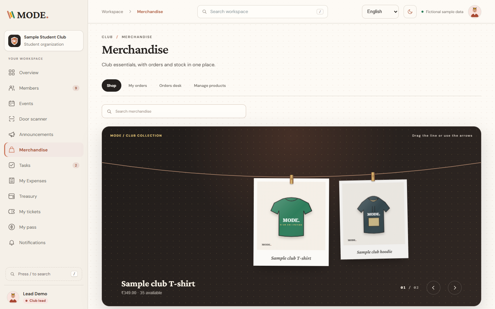 | 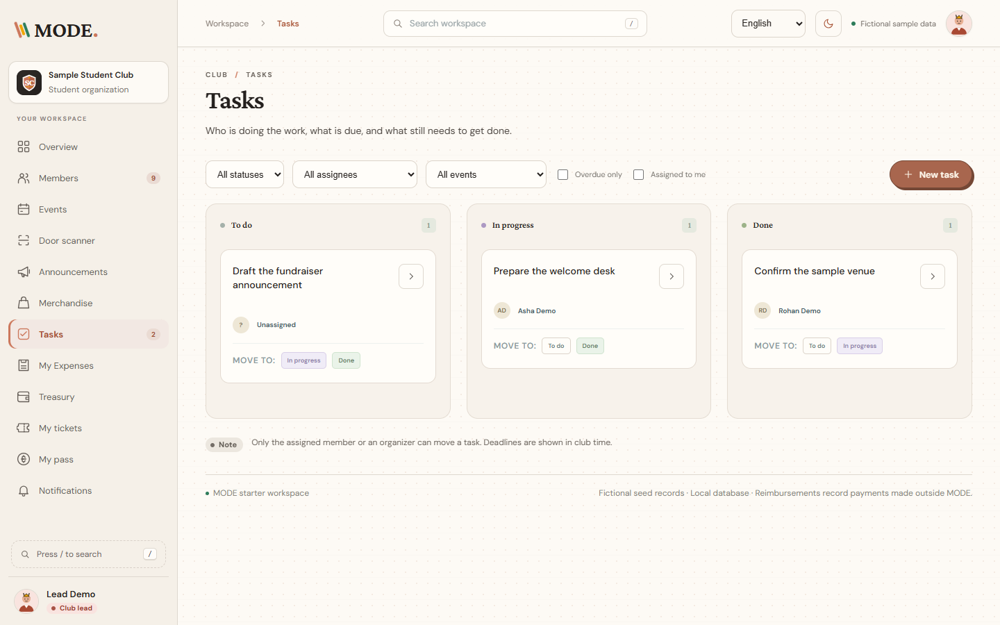 |
| **Treasury and ledger** | **Members** |
| 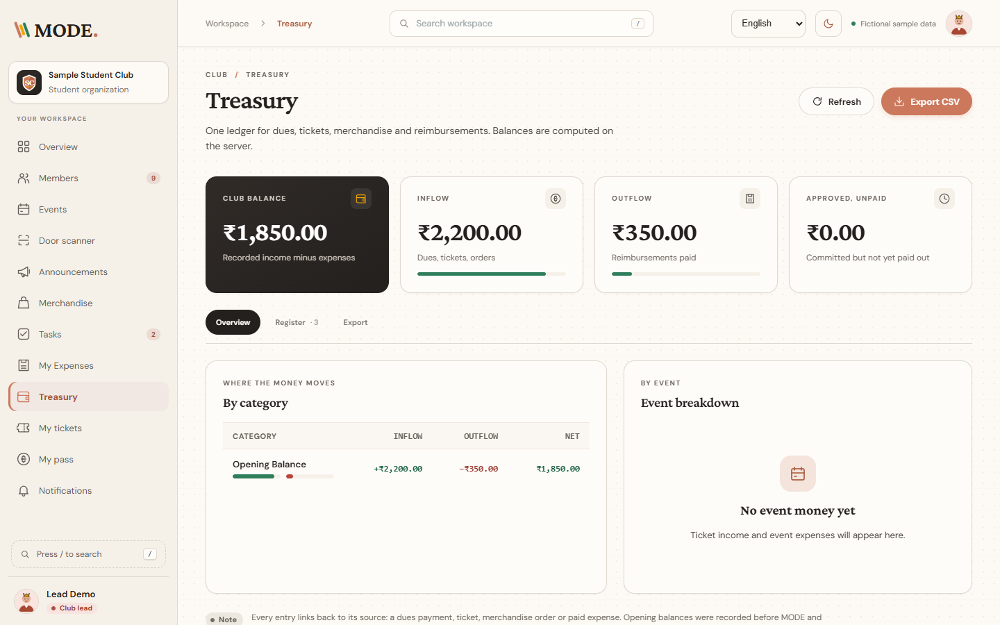 | 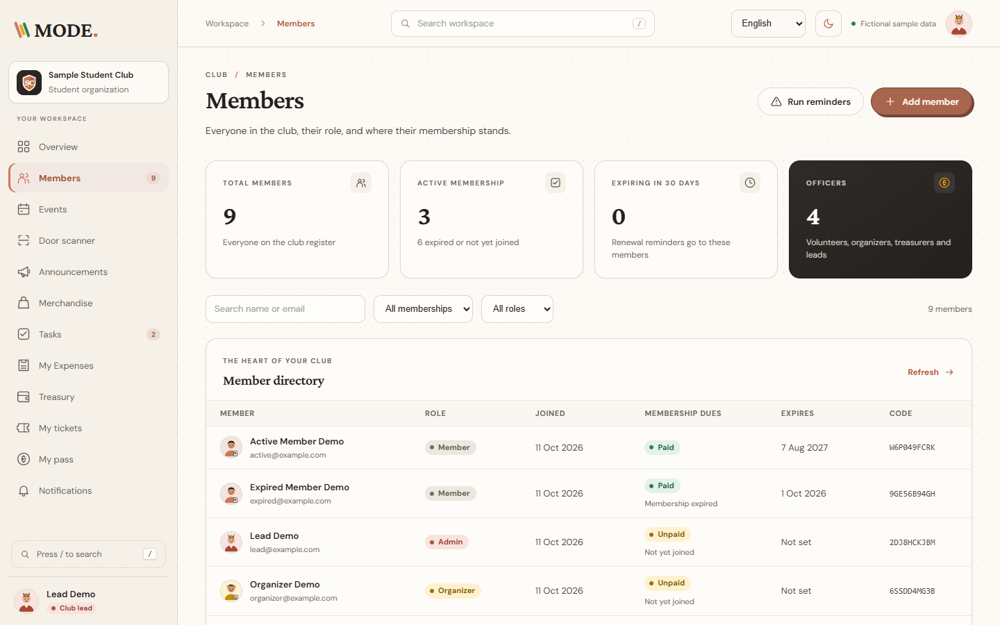 |
| **Announcements** | **Mobile** |
| 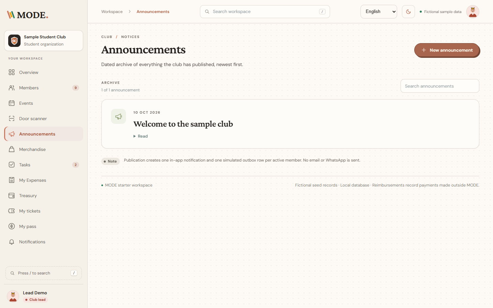 | 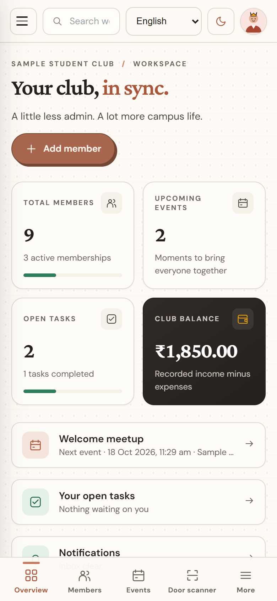 |

## Install

You need **Node.js 24 LTS** (22.13+ on the 22.x line also works; Node 23 does not) and Git. No external database, cloud account or email provider is required.

```sh
git clone https://github.com/nitishssh/MODE.git
cd MODE
npm ci
npm ci --prefix client
npm run auth:setup
```

`auth:setup` writes a private JWT signing key (`MODE_JWT_SECRET`) to `.env.local`; it never overwrites an existing key. See [JWT authentication](docs/AUTHENTICATION.md).

The repository's `.nvmrc` selects Node 24 for `nvm`/`fnm`. Optional settings live in `.env.example`; copy it to `.env.local` if you need them, and never commit that file.

## Run

### Development

```sh
npm run dev
```

Open http://127.0.0.1:3000. The first request creates `.data/mode.sqlite`, applies schema version 17 and loads clearly fictional sample data once. Data persists across restarts.

### Production mode

```sh
npm run build
MODE_DEMO_PASSWORD="<your-password>" npm start
```

Production refuses to seed a new database with the public demo password, so set `MODE_DEMO_PASSWORD` first (PowerShell: `$env:MODE_DEMO_PASSWORD="…"`).

### Docker (prebuilt package)

Each release publishes an image to GitHub Packages:

```sh
docker run -p 3000:3000 -e MODE_DEMO_PASSWORD="<your-password>" -e MODE_JWT_SECRET=<64-hex-chars> -v mode-data:/data ghcr.io/nitishssh/mode:latest
```

Generate the key with `openssl rand -hex 32`. Or build locally with `docker compose up --build`. See [docs/LOCAL-CONTAINER.md](docs/LOCAL-CONTAINER.md).

### Phones on the same Wi-Fi

`npm run dev:lan`, then open `http://<your-computer-LAN-IP>:3000` on the phone. The Expo app in `client/` works with Expo Go; see the [client README](client/README.md).

### PostgreSQL (optional)

Set `DATABASE_URL=postgres://…`. `npm run postgres:up` starts a local server and `npm run postgres:push` copies an existing SQLite database across. See [docs/POSTGRESQL.md](docs/POSTGRESQL.md).

## How to use it

### 1. Sign in

Go to **Sign in** (`/app/login`). The demo panel fills in a synthetic account with one click. All demo accounts share the password `mode-demo-2026` in development (or your `MODE_DEMO_PASSWORD`).

| Account | Role | Try |
|---|---|---|
| `lead@example.com` | Club lead (admin) | Everything, including roles and join codes |
| `organizer@example.com` | Organizer | Members, events, announcements, tasks |
| `treasurer@example.com` | Treasurer | Dues, reimbursements, treasury, CSV export |
| `volunteer@example.com` | Volunteer | Door scanner, assigned tasks |
| `active@example.com` | Paid member | Member pass, tickets, shop, expense claims |
| `expired@example.com` | Lapsed member | Renewal reminder flow |

New students use **Join the Association** to register.

### 2. A semester in MODE

1. **Members** — officers add members (or import a CSV with `npm run club:import`). Recording dues extends membership by 365 days and posts income to the ledger.
2. **Join codes** — a club lead turns on a join code; students who already have a MODE login join with it and appear as members. Anyone can leave a club; their history stays intact.
3. **Events** — create an event with capacity and member/guest prices. Members book a ticket, which holds a seat for 30 minutes until an officer confirms payment.
4. **Door scanner** — volunteers scan the member pass QR (or type the door code). Each ticket admits once; a second scan shows the original check-in time.
5. **Announcements** — publish to the website archive and every active member's notifications in one step.
6. **Merchandise** — add products with sizes and stock. Orders hold stock for 30 minutes; officers confirm payment and mark orders fulfilled.
7. **Tasks** — assign volunteer work and track progress from To do to Done.
8. **Expenses** — members submit claims with a JPG, PNG or PDF receipt; the treasurer approves and pays them.
9. **Treasury** — one ledger for dues, tickets, orders and reimbursements, each entry linked to its source. Export CSV for the faculty adviser.
10. **Several clubs** — if you belong to more than one club, switch from the profile menu in the sidebar.

The interface is available in English and eleven Indian languages from the switcher in the top bar.

### 3. Use it for your real club

The sample data is for trying things out. To start fresh with your own club, see [Real club data](#real-club-data) below.

## Flowcharts

### Getting started

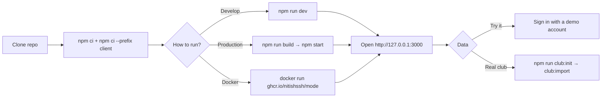

### Membership, joining and leaving

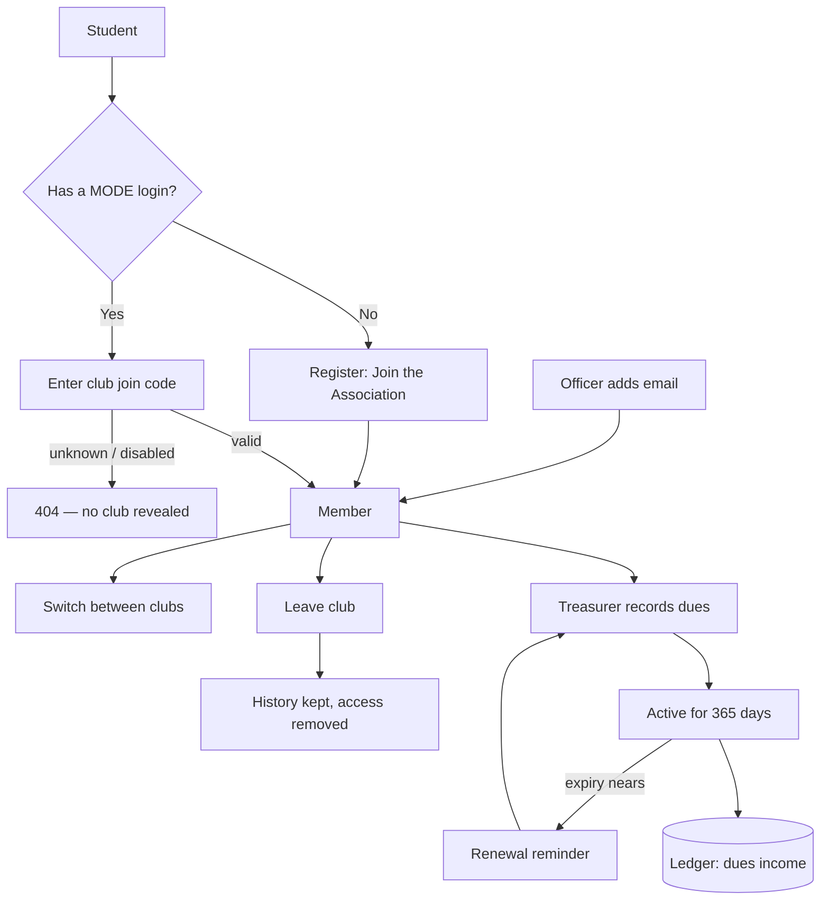

### Event ticket to door check-in

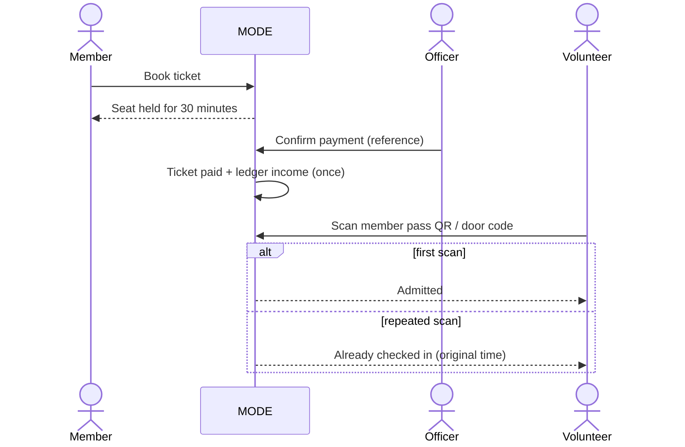

### Merchandise order

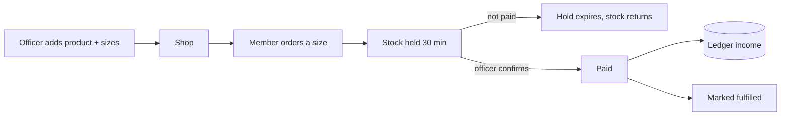

### Expense claim to reimbursement

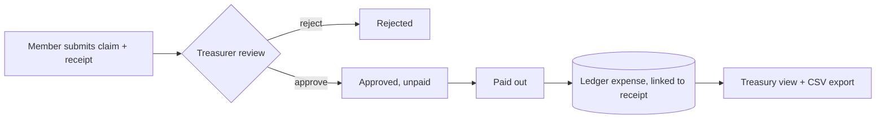

### Announcements and tasks

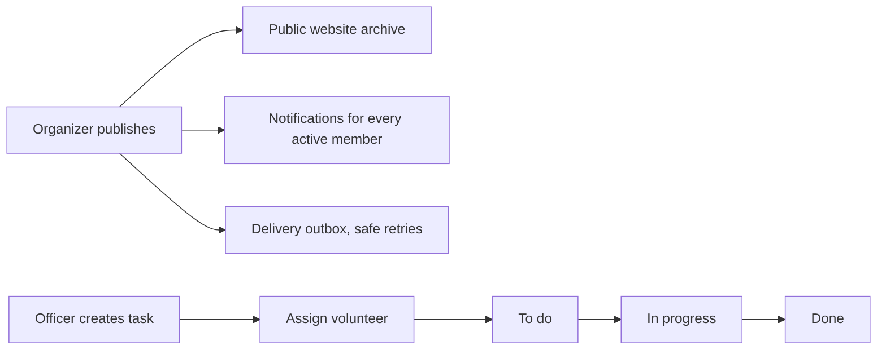

## Verify

```sh
npm run check:all
```

This runs the same checks as CI: version consistency, lint, types and tests for server and Expo client, contract checks, generated schema checks, production builds and restart persistence. Use `npm run check` for a faster backend loop.

## Historical codebase documentation

Start with the [historical codebase guide](docs/CODEBASE.md): architecture and feature status, [source files and shared types](docs/CODE-REFERENCE.md), [database tables and migrations](docs/DATA-MODEL.md), [HTTP APIs](docs/HTTP-API.md), and [setup, walkthroughs and testing](docs/DEVELOPMENT.md). These guides cover commit `a62c6e2` (10 October 2026), with pinned source links. That snapshot predates the Expo client and schema 13; its inventories and setup instructions do not describe current `main`. For current setup, use this README and the [client README](client/README.md).

[Project board](https://github.com/users/nitishssh/projects/14) · [Implementation tickets](https://github.com/nitishssh/MODE/issues) · [Task map](docs/TASKS.md) · [Team ownership](docs/TEAM.md) · [API contracts](docs/API.md) · [Demo checklist](docs/DEMO.md) · [Agent instructions](AGENTS.md)

## Real club data

The starter seeds clearly fictional records so the flows can be tried immediately. To run your own club instead, create a fresh database with no sample data and your real administrator:

```sh
npm run club:init -- --name "Robotics Society" --description "NMIT robotics club" --dues 500 --admin-name "Priya Nair" --admin-email priya@college.edu --admin-password "a-private-password" --reset
```

`--reset` deletes the existing SQLite file (and its receipts) only when it still holds the sample data; a database with real members is left alone unless you add `--force`. `--dues` is the annual membership fee in rupees. Then import the existing register from a CSV with `name,email` columns and optional `role`, `expires_on` (YYYY-MM-DD, for members who have already paid) and `password` columns:

```sh
npm run club:import -- members.csv            # add --dry-run to preview
```

Everything else (events, products, announcements, tasks, dues, tickets) is entered through the workspace at `/app`. The "Fictional sample data" indicator disappears once the sample records are gone. Setting `MODE_SEED=none` (plus `MODE_CLUB_NAME`) before the first request has the same effect as `club:init` for a hosted deployment; `MODE_DEMO_PASSWORD` is then not required.

The repository's `.nvmrc` selects Node 24 for version managers that support it. To verify a fresh checkout, follow [the foundation acceptance check](docs/FOUNDATION.md), including the automated server restart test.

```sh
npm run check:all
npm start
```

`check:all` checks product version consistency, then runs root and Expo lint/types/tests, both contract checks, generated schema verification, production builds, restart persistence and Expo same-origin delivery, matching GitHub Actions. It requires both dependency installs and leaves the Expo delivery build in `.next`; use `npm run build` to prepare a standard web build again. For a shorter backend edit loop, use `npm run check`. See [contributing](CONTRIBUTING.md) for individual checks and [quality tooling](docs/QUALITY.md) for the pending Next.js-specific and Prettier rules.

[VERSION](VERSION) identifies the prepared product version across the server, client and Expo app. See the [changelog](CHANGELOG.md) and [versioning checklist](docs/VERSIONING.md); `npm run check:version` detects mismatched manifest or lockfile versions before release.

The [page routing contract](docs/ROUTING.md) lists the URLs served in each delivery mode. Use Expo web delivery for the paginated task, expense and treasury screens. Standard Next keeps the existing workspace at `/dashboard`; its lists remain unpaginated.

[docs/schema.sql](docs/schema.sql) and [docs/schema.postgres.sql](docs/schema.postgres.sql) contain the current SQLite DDL and its PostgreSQL translation, generated from migrations without exporting member or seed records. Run `npm run schema:dump` after a migration change and commit the result. Both verification commands run `npm run schema:check` to detect stale schema documentation.

Member creation requires an organizer or admin session in both development and production (see [API contracts](docs/API.md)). `MODE_ENABLE_DEMO_WRITES` has been replaced by role-based authorization. `npm start` runs in production mode, which refuses to seed a new database with the public default demo password: set `MODE_DEMO_PASSWORD` in the environment first. Both provided server commands bind to loopback by default.

Native API clients can log in without browser Origin headers and use the returned `token` as `Authorization: Bearer <token>`. For development browser API access, optionally set `MODE_CORS_ORIGINS` to exact comma-separated origins in `.env.local`; this permits reads and bearer requests, while browser login and cookie mutations remain same-origin. Production ignores this allowlist. See [the CORS contract](docs/API.md#development-cors).

## What works today

- Privacy policy at `/privacy`, versioned registration acknowledgement, essential-only or optional saved-preference choices, and camera/file permission explanations. The local demo contact is an example; configure the real operator before public use. See [privacy implementation](docs/PRIVACY.md).

- SDK 57 Expo client in `client/`: registration, cookie-based web login, SecureStore native bearer sessions, permission-driven navigation, QR membership passes and dues, event booking and check-in, merchandise, announcements, task assignment, receipt claims and treasury/source/CSV views. See [the interactive journey](docs/DEMO.md#interactive-client-journey).
- Public landing at `/`, sign-in at `/login`, and an authenticated overview at `/dashboard`. Optional same-origin Expo delivery serves business screens while keeping the Next landing and login pages; `/legacy` retains the original workspace. Native camera scanning, receipt selection and private-file sharing are implemented; bundle compilation does not establish physical-device acceptance.
- Responsive dashboard and navigation for all six club areas.
- Legacy web interface in English and eleven of the most spoken Indian languages (Hindi, Bengali, Marathi, Telugu, Tamil, Gujarati, Urdu, Kannada, Malayalam, Punjabi, Assamese), chosen from the browser's language or the in-app switcher.
- Browser sign-in/sign-out, task editing, receipt-backed expenses, treasury review and ledger CSV export.
- Backend APIs for dues/renewals, simulated reminders, ticket holds, payment confirmation, check-in and merchandise orders with stock holds.
- Announcement publication API with a public dated archive, active-member notifications, atomic simulated outbox delivery and safe retries. See the [announcement demo](docs/DEMO.md#announcement-publication-8).
- SQLite/PostgreSQL-backed dashboard, health check and member directory; bounded v2 member, task, expense and ledger lists.
- Registration, login, logout, signed JWTs backed by revocable hashed sessions, and role-protected member APIs; native bearer tokens and browser HttpOnly cookies share the same session. Run `npm run auth:setup` before signing in; see [JWT authentication](docs/AUTHENTICATION.md).
- Create a member through the authorized API with server validation and case-insensitive duplicate prevention.
- Server-calculated member/event counts and a sample ledger balance in integer paise.
- Fictional records showing how events, announcements, merchandise, volunteer work and finances will fit together.
- Tests, TypeScript and API contract checks, production build, automated server restart acceptance and GitHub Actions configuration.

## Remaining acceptance

WhatsApp preparation is available in `/app/settings`: members can save their number
and preferences; officers can configure a group and inspect queued deliveries.
Announcements queue both audiences, while renewal reminders remain private. Schema
14 adds durable queues with duplicate prevention and conservative retry handling.
The OpenWA sender is not connected yet, so no WhatsApp messages are sent. See
[OpenWA implementation and remaining setup](docs/OPENWA.md).

Physical Android/iOS camera, picker, haptics and sharing, LAN journeys and installed Windows PWA behavior remain tracked in [the MVP tickets](https://github.com/nitishssh/MODE/milestone/1). Selected local browser journeys and automated API/restart checks are recorded in [the demo guide](docs/DEMO.md#interactive-client-journey); they do not complete every native/web acceptance criterion. Payment confirmations record external payments; no gateway transfer or real email is performed.

The starter is a single-club, local development scaffold with synthetic demo accounts. The web and Expo client have sign-in and business screens; physical-device acceptance remains outstanding. Anonymous dashboard responses withhold the member directory and finance data. See [API contracts and demo accounts](docs/API.md) to exercise the authenticated endpoints. Hosted SQLite needs a persistent disk and one writable instance; a serverless ephemeral filesystem is not durable storage. Set `DATABASE_URL=postgres://…` to run the same application on PostgreSQL instead (`npm run postgres:up` starts a local server, `npm run postgres:push` moves an existing SQLite database across); see [docs/POSTGRESQL.md](docs/POSTGRESQL.md). Known schema and workflow gaps are tracked in [docs/DB-AUDIT.md](docs/DB-AUDIT.md).

## Stack and layout

See [code quality and CI](docs/CODE-QUALITY.md) for linting, tests, coverage,
security scanning, dependency updates and the required merge/deployment gate.

Next.js App Router API · Expo Router · React Native Web · React · TypeScript · Zod · native SQLite / PostgreSQL.

```text
client/src/app/          Expo registration, booking and authenticated business screens
src/app/page.tsx          Public landing page
src/app/dashboard/        Authenticated overview (Expo export is optional)
shared/                  Page registry and validated return destinations
src/app/legacy/page.tsx   Existing web workspace
src/app/globals.css       Responsive design, script fallbacks and right-to-left layout
src/app/api/              Auth, memberships, tickets, tasks, expenses and ledger
src/i18n/                 Locale registry, dictionaries (12 languages), formatters and provider
src/lib/contracts.ts     Shared API types
src/lib/database.ts      Database adapter selection and module composition
src/lib/db/              Versioned schema migrations and transaction helpers
docs/schema.sql          Generated DDL for the current schema (`npm run schema:dump`)
docs/schema.postgres.sql Generated PostgreSQL translation of the same schema (`npm run schema:dump`)
src/lib/modules/         Identity, dues, events, workspace and ledger persistence
src/lib/member-validation.ts
src/lib/mutation-guard.ts
tests/                   Persistence, domain and API checks
docs/                    Team, contracts, task map and demo
.github/workflows/ci.yml  Pull request and push checks
```

## Team

| Person | GitHub | Ownership |
|---|---|---|
| Nitish | [@nitishssh](https://github.com/nitishssh) | Integration, announcements, volunteers, reimbursements, scaffold support and release |
| Divyank | [@DIVYANK-BHARDWAJ](https://github.com/DIVYANK-BHARDWAJ) | Shared backend foundation, auth, memberships, tickets, merchandise and module tests |
| Azman | [@Azmanshaikh](https://github.com/Azmanshaikh) | Expo frontend, Member Pass, scanner, forms and treasurer screens |

The 10 October plan assigns the former platform/release role to Nitish. Use one feature branch and one linked PR per ticket; every contributor should own and explain their work. See [CONTRIBUTING.md](CONTRIBUTING.md).
-Please check the detail docs (https://github.com/nitishssh/MODE/wiki)

## LAN and home-screen access

Run `npm run dev:lan` to listen on all network interfaces, then open `http://<computer-LAN-IP>:3000` from a device on the same network. Permit the server through your private-network firewall if needed. Sign in on that same origin; the web workspace uses relative API URLs and does not need a CORS allowlist. Use only synthetic data and a private network for a plain-HTTP demo.

For a production-mode LAN demo, build first, configure `MODE_DEMO_PASSWORD` before the first database seed, and run `npm run start:lan`. Persist the database and its adjacent receipts directory together. A hosted installation needs HTTPS and persistent storage.

The web manifest provides the MODE icon and standalone display metadata. On a supported browser, use its install or Add to Home Screen action when available. Installation support depends on the browser and a secure context; plain HTTP on a LAN address may not qualify. There is no offline cache or service worker: the server must remain reachable. Physical-device installation has not been verified. The Expo shell is in `client/`; native devices use `EXPO_PUBLIC_API_URL` to reach this server.

### Authenticated tasks and reimbursements

The web workspace now has sign-in, a task board, personal expense submissions and treasury review. Task assignment and status changes respect the signed-in member’s permissions. New claims require a JPG, PNG or PDF receipt up to 5 MB, private to their uploader and club finance reviewers. Reimbursements post exactly once to the shared ledger, alongside dues and ticket income. The register links to exact source records and shows the paying officer; its CSV export matches the register totals. Schema v13 hardens the data model (club foreign keys, unique payment references, receipt single-use) on top of v12, which preserved older workflow and ledger records; back up `.data/` before upgrading from an older schema because v13 rebuilds tables. Schema v14 splits login identities (`people`) from club memberships, v15 adds pagination indexes and v16 adds club join codes and membership leaving, neither rebuilding tables. See [API](docs/API.md), [demo walkthrough](docs/DEMO.md) and [local reimbursement verification](docs/REIMBURSEMENT-VERIFICATION.md).

## Languages

The legacy web workspace is available in English and eleven of the most spoken scheduled languages of India: Hindi, Bengali, Marathi, Telugu, Tamil, Gujarati, Urdu, Kannada, Malayalam, Punjabi and Assamese. The language is chosen once per request by one rule: a valid `mode_lang` cookie wins, otherwise the browser's `Accept-Language` header, otherwise English. The switcher in the top bar (and on the sign-in screen) writes that cookie and re-renders the server tree, so `<html lang>` and `dir` are always correct and Urdu renders right-to-left.

Dictionaries live in `src/i18n/dictionaries/<code>.ts`; English is the master and the `Dictionary` type plus `tests/i18n.test.ts` force every language to carry the same keys and placeholders. Only the requested language is loaded, on the server, so other languages are not bundled into the client (the selected dictionary is sent to the browser). Amounts and dates use `Intl` with the matching `*-IN` locale and Latin digits in every language, so figures on screen always match the ledger and the CSV export. API error messages are mapped by their `code` to the active language; the API itself stays English.

The Expo client and guest ticket HTML currently use English labels; the legacy language switcher does not translate those surfaces.

To add a language: append it to `LOCALES` in `src/i18n/locales.ts`, add `src/i18n/dictionaries/<code>.ts` typed as `Dictionary`, and register it in `src/i18n/dictionaries/index.ts`. The test suite fails until every key is translated.
