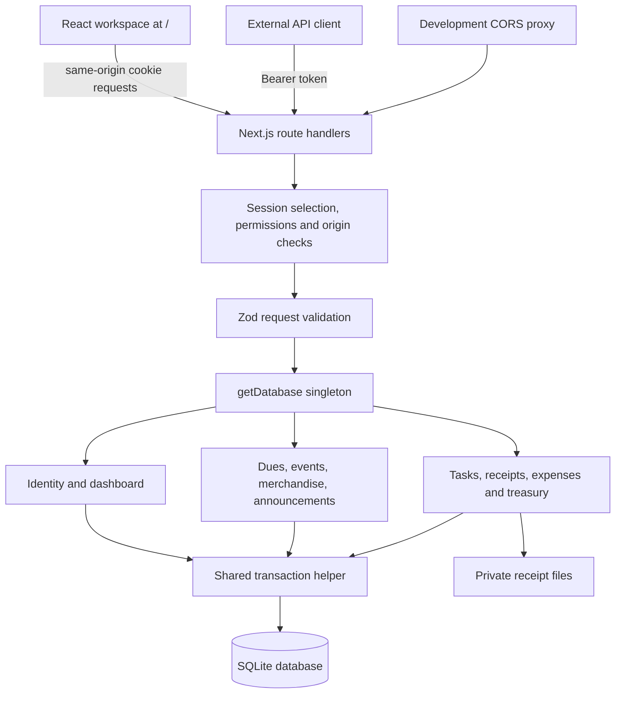
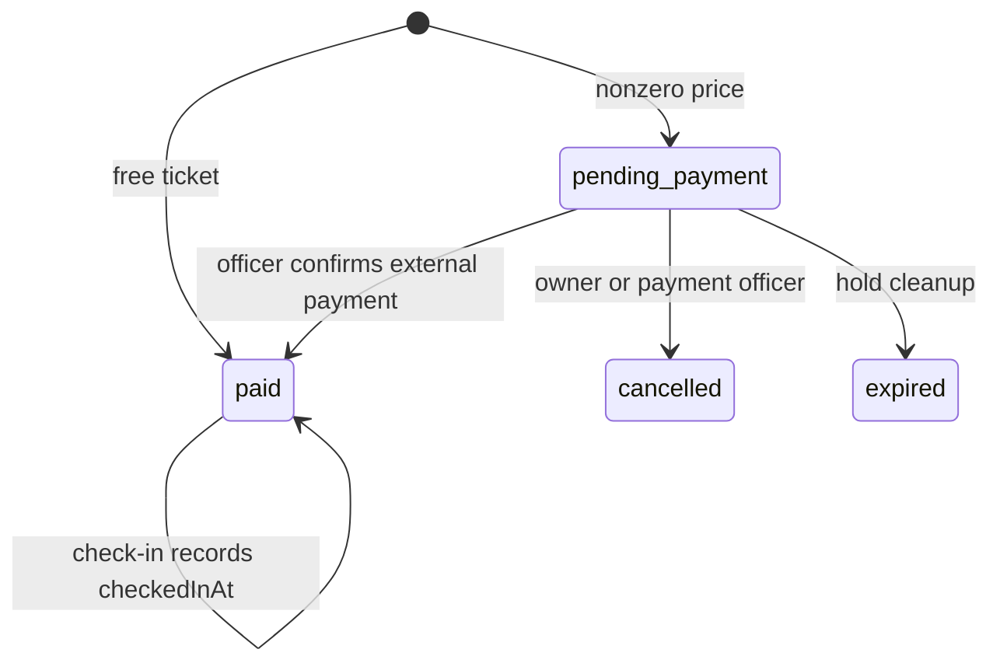

# MODE codebase documentation

This guide documents the pushed `main` snapshot of [nitishssh/MODE](https://github.com/nitishssh/MODE/tree/a62c6e27724eccfafe54f3d85c9ddf066fb7c033), commit `a62c6e27724eccfafe54f3d85c9ddf066fb7c033`, fetched on 10 October 2026. It covers the whole tracked application at that commit, including its web UI, APIs, persistence, configuration and tests. Other branches and unmerged work are outside this snapshot. Source links are pinned to this commit.

This is a historical reference: the snapshot predates the Expo client and schema 12 now on `main`. Use the pinned source links or the fresh-checkout instructions below to reproduce it. For current setup and feature status, use the [root README](../README.md) and [client README](../client/README.md).

## Reading guide

| Document | What you will find |
|---|---|
| [Development guide](DEVELOPMENT.md) | First run, demo walkthrough, configuration, tests, troubleshooting and contribution workflow |
| [Code reference](CODE-REFERENCE.md) | Every tracked file, module responsibilities, exported functions, UI components, shared types and test inventory |
| [Database reference](DATA-MODEL.md) | Migration history, relationships, constraints and every column of the actual migrated schema |
| [HTTP API reference](HTTP-API.md) | Every explicit HTTP handler, permissions, request fields, response envelopes and error behavior |
| This document | Architecture, feature status, important flows and implementation limits |

## What the application does

MODE is a student club workspace. Members, organizers, volunteers and treasurers share one backend for memberships, event tickets, merchandise, announcements, volunteer tasks and finances. The checked-in app uses a fictional sample club and synthetic accounts.

| Area | Implemented backend | Web UI at this commit |
|---|---|---|
| Identity | Registration, login/logout, seven-day sessions, roles, member passes and password assignment | Sign-in/sign-out; officer member creation and directory; no registration or pass-management screen |
| Membership | Officer-recorded dues, 365-day renewal, expiring members, simulated reminders | Directory and membership state; dues collection/renewal screens remain previews |
| Events | Event creation/editing, paid/free member and guest tickets, 30-minute holds, confirmation, scanning and reports | Event cards and officer reports; booking, payment desk and scanner screens remain future work |
| Merchandise | Products, size variants, stock reservations, confirmation, cancellation and fulfilment | Catalogue preview; order button is disabled |
| Announcements | Immediate publication, public archive, active-member notifications, private simulated outbox | Searchable archive; publication, inbox and outbox screens are not implemented |
| Tasks | Create, edit, assign, filter, set deadlines and change status | Working task board and editing flows |
| Reimbursements | Receipt upload/download, submission, independent approval/rejection and payment recording | Working personal expenses and treasury review |
| Ledger | One shared source-linked register, totals, exact source details, CSV and reconciliation helper | Treasury overview, review queue, register, source details and CSV export |
| Delivery | Next.js website, LAN commands, manifest and app icon | Responsive web interface, dark theme and loading/404 screens; no Expo app or offline cache |

Payment confirmation records a payment made outside MODE. It does not charge a card, initiate a UPI payment or transfer a reimbursement. Notifications and outbox rows are simulated; no email or WhatsApp provider is called.

## Stack

The package pins Next.js 16.4.0, React/React DOM 19.3.0 and Zod 4.6.5. TypeScript uses strict checking and the `@/*` alias for `src/*`. Node's native `node:sqlite` supplies the database; there is no ORM or external database service. CSS is handwritten. The recommended runtime is Node 24 LTS, also used in CI.

## Architecture

### Web layer

[`src/app/page.tsx`](https://github.com/nitishssh/MODE/blob/a62c6e27724eccfafe54f3d85c9ddf066fb7c033/src/app/page.tsx) is a client component containing most of the interface. `Home` checks `/api/auth/me`, shows the login form when signed out and mounts `Workspace` when signed in. React state holds loaded data and form/loading/error state; there is no Redux or external query cache.

`Workspace` fetches the dashboard and selects Overview, Members, Events, Announcements, Merchandise, Tasks, My Expenses or Treasury. Hash links such as `/#tasks` and `/#treasury` select sections of the same page, not separate Next.js pages. `TaskBoard`, `TaskCard`, `MyExpenses`, `Treasury` and `EventReportCard` fetch their own detailed APIs. Successful mutations refresh the relevant lists and, where needed, dashboard totals.

Browser requests use relative `/api/...` URLs and the HttpOnly session cookie. The token returned by login is not placed in local storage. The `mode-theme` local-storage value only remembers the light/dark preference; the document's `mode-dark` class selects dark styling. `globals.css` contains the original base rules followed by the paper-theme overrides, responsive navigation, skeletons and 404 styles. Read the full cascade before changing a style.

The root layout imports CSS and Google Fonts stylesheets for DM Sans and Crimson Pro. `loading.tsx` uses the shared skeleton components. `manifest.ts` supplies home-screen metadata and the SVG icon, with no service worker.

### HTTP layer

Handlers live in `src/app/api/**/route.ts`; `/t/[token]/route.ts` is a token-addressed JSON ticket endpoint outside `/api`. Handlers run on Node and explicitly request dynamic execution. Most use `route()` from `http.ts`, which awaits promise-based route parameters and converts domain exceptions to JSON errors. `json()` supplies `Cache-Control: no-store`.

`requireActor()` authenticates, checks cookie mutation origin and optionally requires a permission. Domain modules also enforce permissions and club/ownership rules on sensitive operations. `optionalActor()` supports public reads enriched by identity; an explicitly supplied invalid bearer token fails rather than becoming an anonymous request.

`src/proxy.ts` handles development CORS for `/api/:path*`. It is not the authorization layer. CORS permission does not grant an account permission or exempt browser cookie writes from origin checks.

### Database and domain layer

`getDatabase()` lazily opens the configured SQLite path and caches one store on `globalThis`, including across development reloads. A path change closes the previous store. `openClubDatabase()` applies migrations, creates a shared `DbContext` and composes the domain modules. Tests can inject a clock and a receipt directory.

Identity, dashboard and workspace methods are exposed directly on the store. Dues, announcements, events and merchandise methods have their own namespaces. `db.ledger` is an internal low-level toolkit. Its list, balance and reconciliation helpers operate across the database; HTTP treasury handlers use the actor-scoped workspace methods instead. Internal helpers such as `createClub` are not public HTTP APIs.

The SQLite connection enables foreign keys, a 5-second busy timeout and WAL journaling for disk databases. The outer transaction uses `BEGIN IMMEDIATE` to take the write lock before checking capacity, stock or payment state. Nested transactions use savepoints. Keep callbacks synchronous: awaiting network calls inside this transaction abstraction is not supported.

## Main code flows

### Sign-in and request identity

1. Login validates email/password and applies the origin guard.
2. Identity verifies the salted scrypt hash and creates a random session token.
3. SQLite stores the SHA-256 token hash, expiry and revocation state. The raw token goes to the caller and the browser cookie.
4. Later requests select the bearer header when present; otherwise they use `mode_session`.
5. `getActor()` reads the current member role from SQLite. Permissions and club scope apply to that actor.
6. Logout revokes the selected session. Bearer logout does not clear an unrelated browser cookie.

Changing a role affects subsequent actor resolution. Assigning a password does not itself revoke existing sessions. Officer-created members have no credentials until an admin assigns them; self-registering an already-used email conflicts rather than claiming that record.

### Dues and membership

Eligibility is derived from `expiresOn` against the Asia/Kolkata calendar day. Expiry today is still active; past expiry is expired; null means none. `duesStatus` is historical and is not the pricing eligibility predicate.

`recordDues()` takes the amount from the club configuration (seeded at 50,000 paise, or INR 500). New expiry is `max(today, previous expiry) + 365 days`. A single transaction creates the payment, changes member expiry, posts income and records an audit event. Reusing the club/reference pair for that member is idempotent; reuse for another member conflicts. Renewal reminders create one notification and one simulated outbox row per member/expiry pair.

### Event tickets

Booking checks the event, fixes the price using current membership and atomically increments registered seats only when capacity remains. One live ticket per holder/event is enforced by partial unique indexes. A nonzero price starts a 30-minute `pending_payment` hold; a free ticket starts `paid` without a ledger entry.

Confirmation and its income row commit together. A repeated confirmation of a paid ticket returns `created:false`. Pending cancellation/expiry releases capacity once. Paid-ticket refunds are outside the implemented flow. Check-in accepts a ticket token/code or a member pass, resolves a paid ticket for the selected event and updates only a not-yet-scanned ticket. Membership affects price, but a paid ticket determines admission.

### Merchandise

Orders require a member session. A size variant's stock means currently available units after holds. Creation reserves stock with a conditional update, stores the unit price and limits each member to two unpaid units per variant. Member pricing applies only while membership is active and a member price exists.

The states are `pending_payment -> paid -> fulfilled`, with pending orders also able to become cancelled or expired. Holds last 30 minutes. Confirmation posts one income row; fulfilment records physical handover without posting more income. Cancelling or expiring a pending order returns stock once. Free orders start paid without a ledger row. Paid/fulfilled order cancellation and refunds are not implemented.

### Receipts, reimbursement and the register

1. `POST /api/receipts` accepts a bounded multipart file upload.
2. `saveReceipt()` checks bytes for JPG, PNG or PDF, enforces 5,000,000 bytes and writes a UUID-based filename. SQLite stores private receipt metadata.
3. Submission requires an existing readable receipt owned by the submitter and a positive safe integer amount in paise.
4. A different finance reviewer approves or rejects the submitted claim.
5. Payment recording requires an approved claim and an external payment reference. It atomically moves the claim to paid, posts one expense and records the paying officer in the ledger.
6. The same reference can safely retry a paid claim; a different one conflicts. The reviewer and payer can be different officers.

The ledger is the `transactions` table, shared with dues, tickets, merchandise and the pre-system opening balances. Approval is not an outflow; only payment is. Treasury's `approvedUnpaidPaise` reports the outstanding approved amount separately. Reconciliation checks both ledger-to-source existence and source-to-ledger completeness/value agreement.

### Announcement publication

An organizer/admin submits title, plain-text body and an idempotency key. In one write transaction the server selects active members for that club/date, inserts the publication, snapshots one notification and simulated outbox message per recipient, and records an audit event. Empty audiences are allowed. An identical retry returns the original publication and recipient count even if membership later changes. Reusing a key for different content conflicts.

The archive is public. The notification inbox is scoped to the current member. Outbox inspection requires `outbox:manage` and includes saved recipient addresses; public archive responses omit these details. There are no publication update/delete or external dispatch endpoints.

## Implementation limits and nuances

- The app starts with one sample club. Several domain queries support club scoping, but there is no public club onboarding/switching API.
- Hold expiry is cleaned up during selected operations, not by a background scheduler. Catalogue/event summary reads can show reservations until a cleanup-triggering operation runs.
- The dashboard reads events/products directly and does not apply the dedicated list endpoints' published/active filters. Do not assume it is a filtered public catalogue.
- `/api/membership/expiring` calculates its `asOf` field with the wall clock while its member query uses the injected/application clock. Under a frozen demo clock these can disagree.
- An event report's fundraiser `onTrack` flag is a simple threshold: no goal, or at least 50% raised. It is not a time-based forecast. There is no route to edit the fundraiser goal in this snapshot.
- The database schema has a notification `read_at` column, but no HTTP endpoint for marking notifications read.
- File writes and SQLite are separate storage systems. Failed receipt metadata inserts clean up the new file; a successful upload followed by an abandoned expense can leave an unused receipt. No receipt garbage collector is included.
- Hosted operation needs persistent database and receipt storage. A manifest does not make the app offline-capable, and device installation has not been verified by this documentation task.

## Verification scope

This documentation was derived from the pinned source, route exports, tests, package scripts and an isolated migrated database. Documentation inventory and links were checked. Existing tests are described as code coverage evidence, not as proof that the full suite or production deployment was rerun for this documentation-only change. See [Development](DEVELOPMENT.md) for the exact verification commands.
