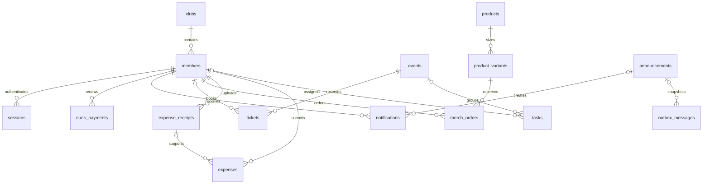

# MODE database reference

Source snapshot: `a62c6e27724eccfafe54f3d85c9ddf066fb7c033`, schema **11**, 10 October 2026. The column/DDL appendix below was obtained by opening a new isolated database through this snapshot's `openClubDatabase()`, then reading SQLite PRAGMA metadata. It does not inspect or publish the working demo database or live member records.

The complete current DDL is generated into [schema.sql](schema.sql) by `npm run schema:dump`; `npm run check` fails when it is stale. The same command writes the PostgreSQL translation to [schema.postgres.sql](schema.postgres.sql); see [POSTGRESQL.md](POSTGRESQL.md) for the mapping rules, the export/load tooling and the runtime migration plan, and [DB-AUDIT.md](DB-AUDIT.md) for the audited gaps in this schema.

See [Architecture](CODEBASE.md), [HTTP API](HTTP-API.md), [code reference](CODE-REFERENCE.md) and [setup/backup instructions](DEVELOPMENT.md).

## Connection and storage

`SQLITE_PATH` defaults to `.data/mode.sqlite`. Disk connections use WAL, foreign keys and a 5000 ms busy timeout. `:memory:` is supported for tests. Receipt files live in the adjacent `receipts` directory unless `openClubDatabase` receives an explicit directory. Database and receipt files form one backup set.

Writes use synchronous `BEGIN IMMEDIATE` transactions, with savepoints for nesting. Migrations run once on open inside a write transaction and update `PRAGMA user_version`. Opening a database newer than this code's schema fails. SQL parameter placeholders bind data values; do not interpolate user values into SQL.

## Released migration history

| Version | Change |
|---|---|
| 1 | Starter members, events, announcements, products, tasks and transactions; fictional seed records |
| 2 | Clubs, roles, password hashes, sessions, audit trail and demo officers |
| 3 | Ledger sources/opening-balance backfill, member pass tokens and active/expired demo members |
| 4 | Annual dues configuration, payments, reminder deduplication, notifications and outbox |
| 6 | Event club/status/description and ticket reservations/payment/check-in schema |
| 8 | Product club/discount/active fields, variants and merchandise orders |
| 9 | Workspace tasks, receipts, expenses, ledger club/event attribution and event fundraiser goals |
| 10 | Rename receipts to expense_receipts and preserve legacy UUID filenames in storage_name |
| 11 | Announcement club/author/retry/audience fields and notification/outbox announcement links |

Versions 5 and 7 are historical gaps; do not reuse them. Append migrations above the latest released version. v10 does not move/delete old receipt files; new uploads use UUID plus detected extension, while legacy extensionless/WebP downloads remain supported.

## Relationships



This diagram shows the main logical relationships; the appendix gives the actual SQL foreign keys. `transactions.source_type/source_id` is a polymorphic application-level link to dues, tickets, orders or expenses, not one SQL foreign key. Opening balances self-reference their own transaction ID internally.

## Invariants and representations

- IDs are stored as TEXT; most new records use UUIDs, while stable demo IDs use descriptive strings. Do not assume all resource IDs are UUIDs. Receipt submission specifically validates receipt IDs as UUIDs.
- Money is stored in integer paise. Ledger amounts must be positive; kind supplies direction. Ticket/product prices can be zero. Free bookings/orders have no zero-value ledger row.
- `members.email` is globally unique with NOCASE collation. Club scope is a query/actor boundary, not a separate email namespace.
- Membership is derived from expiry; it is not a stored active flag. Asia/Kolkata expiry today is active even when dues_status is stale.
- `transactions(source_type,source_id)` is unique. Every actual financial transition posts once in the same transaction; reconciliation also finds missing or mismatched postings.
- Ticket partial indexes allow one live pending/paid member or guest-email ticket per event. A row must identify exactly one of member_id or guest_email. Capacity includes legacy seeded registrations as well as new holds/tickets.
- Variant stock is available stock. Order holds decrement it immediately and cancellation/expiry restores it once. Product stock aggregates variants.
- Claim status is submitted/approved/rejected/paid. New claims require a readable owned receipt at the application boundary; the nullable SQL receipt_id preserves historical claims.
- Notification/outbox uniqueness on announcement_id/member_id prevents duplicate announcement deliveries. Nullable announcement links preserve older dues rows.
- The schema allows outbox simulated/pending/sent/failed states; the current feature creates simulated rows only. A permitted database state does not prove a dispatcher exists.
- Passwords are scrypt hashes and session tokens are SHA-256 hashes. Pass QR tokens are stored credentials; public serializers intentionally restrict their exposure.
- Several columns added to historical tables are nullable or lack full SQL foreign keys. The schema below records storage constraints; module/route validation supplies additional guarantees. In SQLite a TEXT PRIMARY KEY does not automatically appear as NOT NULL in PRAGMA metadata.

## Table index

| Table | Purpose |
|---|---|
| [announcements](#announcements) | Published plain-text archive, author, durable retry key and frozen recipient count. |
| [audit_events](#audit_events) | Actor/entity/action trail; details contains optional serialized JSON. |
| [clubs](#clubs) | Club identity and annual dues configuration; public self-registration uses the default sample club. |
| [dues_payments](#dues_payments) | Recorded external dues payments with previous/new expiry and officer attribution. |
| [events](#events) | Event schedule, prices, capacity/registered counters, publication status and fundraiser goal. |
| [expense_receipts](#expense_receipts) | Private attachment metadata and storage name; binary bytes live on disk. |
| [expenses](#expenses) | Receipt-backed claims, independent review, payment reference and state timestamps. |
| [members](#members) | Club membership, role, credentials, expiry and unique member pass values. |
| [membership_reminders](#membership_reminders) | Deduplication of renewal reminders by member and expiry date. |
| [merch_orders](#merch_orders) | Member orders with saved pricing, holds, confirmation and fulfilment attribution. |
| [notifications](#notifications) | Private in-app messages per member, optionally linked to an announcement. |
| [outbox_messages](#outbox_messages) | Recipient/subject/body snapshots for simulated delivery; schema permits future delivery states. |
| [product_variants](#product_variants) | Per-size available stock; holds are already deducted. |
| [products](#products) | Catalogue details, price, optional member discount and aggregate available stock. |
| [sessions](#sessions) | Hashed session references with creation/expiry/revocation timestamps. |
| [tasks](#tasks) | Assignment, event linkage, status, deadline and description; keeps legacy assignee text. |
| [tickets](#tickets) | Member or guest reservations, frozen price, hold/payment/check-in state and private pass values. |
| [transactions](#transactions) | Shared posted ledger for opening balances, dues, tickets, merchandise and reimbursements. |

## Exact migrated schema

Column flags below report declared SQLite metadata. DDL includes checks and UNIQUE constraints; separate index definitions are also included. Defaults shown as `—` mean no declared default. SQL type is the declared affinity, not the TypeScript response type.

### announcements

Published plain-text archive, author, durable retry key and frozen recipient count.

| Column | SQL type | Declared NOT NULL | PK position | Default |
|---|---|---|---|---|
| `id` | TEXT | no | 1 | — |
| `title` | TEXT | yes | — | — |
| `body` | TEXT | yes | — | — |
| `published_at` | TEXT | yes | — | — |
| `club_id` | TEXT | yes | — | `'club-sample'` |
| `published_by` | TEXT | no | — | — |
| `idempotency_key` | TEXT | no | — | — |
| `recipient_count` | INTEGER | yes | — | `0` |

```sql
CREATE TABLE announcements (
      id TEXT PRIMARY KEY,
      title TEXT NOT NULL,
      body TEXT NOT NULL,
      published_at TEXT NOT NULL
    , club_id TEXT NOT NULL DEFAULT 'club-sample', published_by TEXT REFERENCES members(id), idempotency_key TEXT, recipient_count INTEGER NOT NULL DEFAULT 0 CHECK (recipient_count >= 0));
CREATE UNIQUE INDEX announcements_request_idx ON announcements (club_id, idempotency_key);
CREATE INDEX announcements_archive_idx ON announcements (club_id, published_at DESC, id);
```

| Foreign key | References | On delete |
|---|---|---|
| `published_by` | `members.id` | NO ACTION |

### audit_events

Actor/entity/action trail; details contains optional serialized JSON.

| Column | SQL type | Declared NOT NULL | PK position | Default |
|---|---|---|---|---|
| `id` | TEXT | no | 1 | — |
| `club_id` | TEXT | yes | — | — |
| `actor_id` | TEXT | no | — | — |
| `action` | TEXT | yes | — | — |
| `entity_type` | TEXT | yes | — | — |
| `entity_id` | TEXT | yes | — | — |
| `details` | TEXT | no | — | — |
| `occurred_at` | TEXT | yes | — | — |

```sql
CREATE TABLE audit_events (
      id TEXT PRIMARY KEY,
      club_id TEXT NOT NULL REFERENCES clubs(id),
      actor_id TEXT REFERENCES members(id),
      action TEXT NOT NULL,
      entity_type TEXT NOT NULL,
      entity_id TEXT NOT NULL,
      details TEXT,
      occurred_at TEXT NOT NULL
    );
CREATE INDEX audit_events_entity_idx ON audit_events (club_id, entity_type, entity_id);
```

| Foreign key | References | On delete |
|---|---|---|
| `actor_id` | `members.id` | NO ACTION |
| `club_id` | `clubs.id` | NO ACTION |

### clubs

Club identity and annual dues configuration; public self-registration uses the default sample club.

| Column | SQL type | Declared NOT NULL | PK position | Default |
|---|---|---|---|---|
| `id` | TEXT | no | 1 | — |
| `name` | TEXT | yes | — | — |
| `description` | TEXT | yes | — | — |
| `created_at` | TEXT | yes | — | — |
| `annual_dues_paise` | INTEGER | yes | — | `50000` |

```sql
CREATE TABLE clubs (
      id TEXT PRIMARY KEY,
      name TEXT NOT NULL,
      description TEXT NOT NULL,
      created_at TEXT NOT NULL
    , annual_dues_paise INTEGER NOT NULL DEFAULT 50000 CHECK (annual_dues_paise > 0));
```

### dues_payments

Recorded external dues payments with previous/new expiry and officer attribution.

| Column | SQL type | Declared NOT NULL | PK position | Default |
|---|---|---|---|---|
| `id` | TEXT | no | 1 | — |
| `club_id` | TEXT | yes | — | — |
| `member_id` | TEXT | yes | — | — |
| `reference` | TEXT | yes | — | — |
| `amount_paise` | INTEGER | yes | — | — |
| `previous_expires_on` | TEXT | no | — | — |
| `new_expires_on` | TEXT | yes | — | — |
| `recorded_by` | TEXT | yes | — | — |
| `recorded_at` | TEXT | yes | — | — |

```sql
CREATE TABLE dues_payments (
      id TEXT PRIMARY KEY,
      club_id TEXT NOT NULL REFERENCES clubs(id),
      member_id TEXT NOT NULL REFERENCES members(id),
      reference TEXT NOT NULL,
      amount_paise INTEGER NOT NULL CHECK (amount_paise > 0),
      previous_expires_on TEXT,
      new_expires_on TEXT NOT NULL,
      recorded_by TEXT NOT NULL REFERENCES members(id),
      recorded_at TEXT NOT NULL,
      UNIQUE (club_id, reference)
    );
CREATE INDEX dues_payments_member_idx ON dues_payments (club_id, member_id);
```

| Foreign key | References | On delete |
|---|---|---|
| `recorded_by` | `members.id` | NO ACTION |
| `member_id` | `members.id` | NO ACTION |
| `club_id` | `clubs.id` | NO ACTION |

### events

Event schedule, prices, capacity/registered counters, publication status and fundraiser goal.

| Column | SQL type | Declared NOT NULL | PK position | Default |
|---|---|---|---|---|
| `id` | TEXT | no | 1 | — |
| `title` | TEXT | yes | — | — |
| `starts_at` | TEXT | yes | — | — |
| `venue` | TEXT | yes | — | — |
| `capacity` | INTEGER | yes | — | — |
| `registered` | INTEGER | yes | — | — |
| `member_price_paise` | INTEGER | yes | — | — |
| `guest_price_paise` | INTEGER | yes | — | — |
| `club_id` | TEXT | yes | — | `'club-sample'` |
| `status` | TEXT | yes | — | `'published'` |
| `description` | TEXT | yes | — | `''` |
| `fundraiser_goal_paise` | INTEGER | yes | — | `0` |

```sql
CREATE TABLE events (
      id TEXT PRIMARY KEY,
      title TEXT NOT NULL,
      starts_at TEXT NOT NULL,
      venue TEXT NOT NULL,
      capacity INTEGER NOT NULL CHECK (capacity >= 0),
      registered INTEGER NOT NULL CHECK (registered >= 0 AND registered <= capacity),
      member_price_paise INTEGER NOT NULL CHECK (member_price_paise >= 0),
      guest_price_paise INTEGER NOT NULL CHECK (guest_price_paise >= 0)
    , club_id TEXT NOT NULL DEFAULT 'club-sample', status TEXT NOT NULL DEFAULT 'published' CHECK (status IN ('draft', 'published', 'cancelled')), description TEXT NOT NULL DEFAULT '', fundraiser_goal_paise INTEGER NOT NULL DEFAULT 0
      CHECK (fundraiser_goal_paise >= 0));
CREATE INDEX events_club_idx ON events (club_id, starts_at);
```

### expense_receipts

Private attachment metadata and storage name; binary bytes live on disk.

| Column | SQL type | Declared NOT NULL | PK position | Default |
|---|---|---|---|---|
| `id` | TEXT | no | 1 | — |
| `club_id` | TEXT | yes | — | — |
| `uploader_id` | TEXT | yes | — | — |
| `filename` | TEXT | yes | — | — |
| `mime_type` | TEXT | yes | — | — |
| `size_bytes` | INTEGER | yes | — | — |
| `uploaded_at` | TEXT | yes | — | — |
| `storage_name` | TEXT | no | — | — |

```sql
CREATE TABLE "expense_receipts" (
      id TEXT PRIMARY KEY,
      club_id TEXT NOT NULL REFERENCES clubs(id),
      uploader_id TEXT NOT NULL REFERENCES members(id) ON DELETE RESTRICT,
      filename TEXT NOT NULL,
      mime_type TEXT NOT NULL,
      size_bytes INTEGER NOT NULL CHECK (size_bytes > 0),
      uploaded_at TEXT NOT NULL
    , storage_name TEXT);
CREATE INDEX receipts_owner_idx ON "expense_receipts" (club_id, uploader_id);
```

| Foreign key | References | On delete |
|---|---|---|
| `uploader_id` | `members.id` | RESTRICT |
| `club_id` | `clubs.id` | NO ACTION |

### expenses

Receipt-backed claims, independent review, payment reference and state timestamps.

| Column | SQL type | Declared NOT NULL | PK position | Default |
|---|---|---|---|---|
| `id` | TEXT | no | 1 | — |
| `club_id` | TEXT | yes | — | — |
| `submitter_id` | TEXT | yes | — | — |
| `amount_paise` | INTEGER | yes | — | — |
| `purpose` | TEXT | yes | — | — |
| `receipt_id` | TEXT | no | — | — |
| `receipt_reference` | TEXT | no | — | — |
| `event_id` | TEXT | no | — | — |
| `status` | TEXT | yes | — | `'submitted'` |
| `reviewer_id` | TEXT | no | — | — |
| `rejection_note` | TEXT | no | — | — |
| `payment_reference` | TEXT | no | — | — |
| `submitted_at` | TEXT | yes | — | — |
| `reviewed_at` | TEXT | no | — | — |
| `paid_at` | TEXT | no | — | — |

```sql
CREATE TABLE expenses (
      id TEXT PRIMARY KEY,
      club_id TEXT NOT NULL REFERENCES clubs(id),
      submitter_id TEXT NOT NULL REFERENCES members(id) ON DELETE RESTRICT,
      amount_paise INTEGER NOT NULL CHECK (amount_paise > 0),
      purpose TEXT NOT NULL,
      receipt_id TEXT REFERENCES "expense_receipts"(id),
      receipt_reference TEXT,
      event_id TEXT REFERENCES events(id) ON DELETE SET NULL,
      status TEXT NOT NULL CHECK (status IN ('submitted', 'approved', 'rejected', 'paid'))
        DEFAULT 'submitted',
      reviewer_id TEXT REFERENCES members(id),
      rejection_note TEXT,
      payment_reference TEXT,
      submitted_at TEXT NOT NULL,
      reviewed_at TEXT,
      paid_at TEXT
    );
CREATE INDEX expenses_club_status_idx ON expenses (club_id, status, submitted_at);
CREATE INDEX expenses_submitter_idx ON expenses (club_id, submitter_id, submitted_at);
```

| Foreign key | References | On delete |
|---|---|---|
| `reviewer_id` | `members.id` | NO ACTION |
| `event_id` | `events.id` | SET NULL |
| `receipt_id` | `expense_receipts.id` | NO ACTION |
| `submitter_id` | `members.id` | RESTRICT |
| `club_id` | `clubs.id` | NO ACTION |

### members

Club membership, role, credentials, expiry and unique member pass values.

| Column | SQL type | Declared NOT NULL | PK position | Default |
|---|---|---|---|---|
| `id` | TEXT | no | 1 | — |
| `name` | TEXT | yes | — | — |
| `email` | TEXT | yes | — | — |
| `joined_at` | TEXT | yes | — | — |
| `expires_on` | TEXT | no | — | — |
| `dues_status` | TEXT | yes | — | — |
| `club_id` | TEXT | yes | — | `'club-sample'` |
| `role` | TEXT | yes | — | `'member'` |
| `password_hash` | TEXT | no | — | — |
| `qr_token` | TEXT | no | — | — |
| `short_code` | TEXT | no | — | — |

```sql
CREATE TABLE members (
      id TEXT PRIMARY KEY,
      name TEXT NOT NULL,
      email TEXT NOT NULL COLLATE NOCASE UNIQUE,
      joined_at TEXT NOT NULL,
      expires_on TEXT,
      dues_status TEXT NOT NULL CHECK (dues_status IN ('paid', 'unpaid'))
    , club_id TEXT NOT NULL DEFAULT 'club-sample', role TEXT NOT NULL DEFAULT 'member'
      CHECK (role IN ('member', 'volunteer', 'organizer', 'treasurer', 'admin')), password_hash TEXT, qr_token TEXT, short_code TEXT);
CREATE INDEX members_club_idx ON members (club_id);
CREATE UNIQUE INDEX members_qr_token_idx ON members (qr_token);
CREATE UNIQUE INDEX members_short_code_idx ON members (short_code);
CREATE INDEX membership_expiry_idx ON members (club_id, expires_on);
```

### membership_reminders

Deduplication of renewal reminders by member and expiry date.

| Column | SQL type | Declared NOT NULL | PK position | Default |
|---|---|---|---|---|
| `member_id` | TEXT | yes | — | — |
| `expires_on` | TEXT | yes | — | — |
| `club_id` | TEXT | yes | — | — |
| `sent_at` | TEXT | yes | — | — |

```sql
CREATE TABLE membership_reminders (
      member_id TEXT NOT NULL REFERENCES members(id),
      expires_on TEXT NOT NULL,
      club_id TEXT NOT NULL REFERENCES clubs(id),
      sent_at TEXT NOT NULL,
      UNIQUE (member_id, expires_on)
    );
```

| Foreign key | References | On delete |
|---|---|---|
| `club_id` | `clubs.id` | NO ACTION |
| `member_id` | `members.id` | NO ACTION |

### merch_orders

Member orders with saved pricing, holds, confirmation and fulfilment attribution.

| Column | SQL type | Declared NOT NULL | PK position | Default |
|---|---|---|---|---|
| `id` | TEXT | no | 1 | — |
| `club_id` | TEXT | yes | — | — |
| `member_id` | TEXT | yes | — | — |
| `product_id` | TEXT | yes | — | — |
| `variant_id` | TEXT | yes | — | — |
| `quantity` | INTEGER | yes | — | — |
| `unit_price_paise` | INTEGER | yes | — | — |
| `total_paise` | INTEGER | yes | — | — |
| `pricing` | TEXT | yes | — | — |
| `status` | TEXT | yes | — | — |
| `hold_expires_at` | TEXT | no | — | — |
| `paid_at` | TEXT | no | — | — |
| `payment_reference` | TEXT | no | — | — |
| `confirmed_by` | TEXT | no | — | — |
| `fulfilled_at` | TEXT | no | — | — |
| `fulfilled_by` | TEXT | no | — | — |
| `created_at` | TEXT | yes | — | — |
| `updated_at` | TEXT | yes | — | — |

```sql
CREATE TABLE merch_orders (
      id TEXT PRIMARY KEY,
      club_id TEXT NOT NULL REFERENCES clubs(id),
      member_id TEXT NOT NULL REFERENCES members(id),
      product_id TEXT NOT NULL REFERENCES products(id),
      variant_id TEXT NOT NULL REFERENCES product_variants(id),
      quantity INTEGER NOT NULL CHECK (quantity > 0),
      unit_price_paise INTEGER NOT NULL CHECK (unit_price_paise >= 0),
      total_paise INTEGER NOT NULL CHECK (total_paise >= 0),
      pricing TEXT NOT NULL CHECK (pricing IN ('member', 'standard')),
      status TEXT NOT NULL CHECK (status IN ('pending_payment', 'paid', 'fulfilled', 'cancelled', 'expired')),
      hold_expires_at TEXT,
      paid_at TEXT,
      payment_reference TEXT,
      confirmed_by TEXT REFERENCES members(id),
      fulfilled_at TEXT,
      fulfilled_by TEXT REFERENCES members(id),
      created_at TEXT NOT NULL,
      updated_at TEXT NOT NULL,
      CHECK (status <> 'pending_payment' OR hold_expires_at IS NOT NULL)
    );
CREATE INDEX merch_orders_status_hold_idx ON merch_orders (status, hold_expires_at);
CREATE INDEX merch_orders_variant_status_idx ON merch_orders (variant_id, status, member_id);
CREATE INDEX merch_orders_member_idx ON merch_orders (member_id, created_at);
```

| Foreign key | References | On delete |
|---|---|---|
| `fulfilled_by` | `members.id` | NO ACTION |
| `confirmed_by` | `members.id` | NO ACTION |
| `variant_id` | `product_variants.id` | NO ACTION |
| `product_id` | `products.id` | NO ACTION |
| `member_id` | `members.id` | NO ACTION |
| `club_id` | `clubs.id` | NO ACTION |

### notifications

Private in-app messages per member, optionally linked to an announcement.

| Column | SQL type | Declared NOT NULL | PK position | Default |
|---|---|---|---|---|
| `id` | TEXT | no | 1 | — |
| `club_id` | TEXT | yes | — | — |
| `member_id` | TEXT | yes | — | — |
| `kind` | TEXT | yes | — | — |
| `title` | TEXT | yes | — | — |
| `body` | TEXT | yes | — | — |
| `created_at` | TEXT | yes | — | — |
| `read_at` | TEXT | no | — | — |
| `announcement_id` | TEXT | no | — | — |

```sql
CREATE TABLE notifications (
      id TEXT PRIMARY KEY,
      club_id TEXT NOT NULL REFERENCES clubs(id),
      member_id TEXT NOT NULL REFERENCES members(id),
      kind TEXT NOT NULL,
      title TEXT NOT NULL,
      body TEXT NOT NULL,
      created_at TEXT NOT NULL,
      read_at TEXT
    , announcement_id TEXT REFERENCES announcements(id));
CREATE INDEX notifications_member_idx ON notifications (member_id, created_at);
CREATE UNIQUE INDEX notifications_announcement_recipient_idx ON notifications (announcement_id, member_id);
```

| Foreign key | References | On delete |
|---|---|---|
| `announcement_id` | `announcements.id` | NO ACTION |
| `member_id` | `members.id` | NO ACTION |
| `club_id` | `clubs.id` | NO ACTION |

### outbox_messages

Recipient/subject/body snapshots for simulated delivery; schema permits future delivery states.

| Column | SQL type | Declared NOT NULL | PK position | Default |
|---|---|---|---|---|
| `id` | TEXT | no | 1 | — |
| `club_id` | TEXT | yes | — | — |
| `member_id` | TEXT | no | — | — |
| `kind` | TEXT | yes | — | — |
| `recipient_email` | TEXT | yes | — | — |
| `subject` | TEXT | yes | — | — |
| `body` | TEXT | yes | — | — |
| `status` | TEXT | yes | — | — |
| `created_at` | TEXT | yes | — | — |
| `announcement_id` | TEXT | no | — | — |

```sql
CREATE TABLE outbox_messages (
      id TEXT PRIMARY KEY,
      club_id TEXT NOT NULL REFERENCES clubs(id),
      member_id TEXT REFERENCES members(id),
      kind TEXT NOT NULL,
      recipient_email TEXT NOT NULL,
      subject TEXT NOT NULL,
      body TEXT NOT NULL,
      status TEXT NOT NULL CHECK (status IN ('simulated', 'pending', 'sent', 'failed')),
      created_at TEXT NOT NULL
    , announcement_id TEXT REFERENCES announcements(id));
CREATE UNIQUE INDEX outbox_announcement_recipient_idx ON outbox_messages (announcement_id, member_id);
```

| Foreign key | References | On delete |
|---|---|---|
| `announcement_id` | `announcements.id` | NO ACTION |
| `member_id` | `members.id` | NO ACTION |
| `club_id` | `clubs.id` | NO ACTION |

### product_variants

Per-size available stock; holds are already deducted.

| Column | SQL type | Declared NOT NULL | PK position | Default |
|---|---|---|---|---|
| `id` | TEXT | no | 1 | — |
| `club_id` | TEXT | yes | — | — |
| `product_id` | TEXT | yes | — | — |
| `size` | TEXT | yes | — | — |
| `stock` | INTEGER | yes | — | — |

```sql
CREATE TABLE product_variants (
      id TEXT PRIMARY KEY,
      club_id TEXT NOT NULL REFERENCES clubs(id),
      product_id TEXT NOT NULL REFERENCES products(id),
      size TEXT NOT NULL,
      stock INTEGER NOT NULL CHECK (stock >= 0),
      UNIQUE (product_id, size)
    );
CREATE INDEX product_variants_product_idx ON product_variants (product_id);
```

| Foreign key | References | On delete |
|---|---|---|
| `product_id` | `products.id` | NO ACTION |
| `club_id` | `clubs.id` | NO ACTION |

### products

Catalogue details, price, optional member discount and aggregate available stock.

| Column | SQL type | Declared NOT NULL | PK position | Default |
|---|---|---|---|---|
| `id` | TEXT | no | 1 | — |
| `name` | TEXT | yes | — | — |
| `price_paise` | INTEGER | yes | — | — |
| `stock` | INTEGER | yes | — | — |
| `club_id` | TEXT | yes | — | `'club-sample'` |
| `description` | TEXT | yes | — | `''` |
| `member_price_paise` | INTEGER | no | — | — |
| `active` | INTEGER | yes | — | `1` |

```sql
CREATE TABLE products (
      id TEXT PRIMARY KEY,
      name TEXT NOT NULL,
      price_paise INTEGER NOT NULL CHECK (price_paise >= 0),
      stock INTEGER NOT NULL CHECK (stock >= 0)
    , club_id TEXT NOT NULL DEFAULT 'club-sample', description TEXT NOT NULL DEFAULT '', member_price_paise INTEGER CHECK (member_price_paise IS NULL OR member_price_paise >= 0), active INTEGER NOT NULL DEFAULT 1 CHECK (active IN (0, 1)));
```

### sessions

Hashed session references with creation/expiry/revocation timestamps.

| Column | SQL type | Declared NOT NULL | PK position | Default |
|---|---|---|---|---|
| `id` | TEXT | no | 1 | — |
| `club_id` | TEXT | yes | — | — |
| `member_id` | TEXT | yes | — | — |
| `token_hash` | TEXT | yes | — | — |
| `created_at` | TEXT | yes | — | — |
| `expires_at` | TEXT | yes | — | — |
| `revoked_at` | TEXT | no | — | — |

```sql
CREATE TABLE sessions (
      id TEXT PRIMARY KEY,
      club_id TEXT NOT NULL REFERENCES clubs(id),
      member_id TEXT NOT NULL REFERENCES members(id),
      token_hash TEXT NOT NULL UNIQUE,
      created_at TEXT NOT NULL,
      expires_at TEXT NOT NULL,
      revoked_at TEXT
    );
CREATE INDEX sessions_member_idx ON sessions (member_id);
```

| Foreign key | References | On delete |
|---|---|---|
| `member_id` | `members.id` | NO ACTION |
| `club_id` | `clubs.id` | NO ACTION |

### tasks

Assignment, event linkage, status, deadline and description; keeps legacy assignee text.

| Column | SQL type | Declared NOT NULL | PK position | Default |
|---|---|---|---|---|
| `id` | TEXT | no | 1 | — |
| `title` | TEXT | yes | — | — |
| `assignee` | TEXT | yes | — | — |
| `status` | TEXT | yes | — | — |
| `club_id` | TEXT | yes | — | `'club-sample'` |
| `description` | TEXT | no | — | — |
| `assignee_id` | TEXT | no | — | — |
| `event_id` | TEXT | no | — | — |
| `due_at` | TEXT | no | — | — |
| `created_at` | TEXT | no | — | — |

```sql
CREATE TABLE tasks (
      id TEXT PRIMARY KEY,
      title TEXT NOT NULL,
      assignee TEXT NOT NULL,
      status TEXT NOT NULL CHECK (status IN ('todo', 'in_progress', 'done'))
    , club_id TEXT NOT NULL DEFAULT 'club-sample', description TEXT, assignee_id TEXT REFERENCES members(id) ON DELETE SET NULL, event_id TEXT REFERENCES events(id) ON DELETE SET NULL, due_at TEXT, created_at TEXT);
CREATE INDEX tasks_club_idx ON tasks (club_id, created_at);
```

| Foreign key | References | On delete |
|---|---|---|
| `event_id` | `events.id` | SET NULL |
| `assignee_id` | `members.id` | SET NULL |

### tickets

Member or guest reservations, frozen price, hold/payment/check-in state and private pass values.

| Column | SQL type | Declared NOT NULL | PK position | Default |
|---|---|---|---|---|
| `id` | TEXT | no | 1 | — |
| `club_id` | TEXT | yes | — | — |
| `event_id` | TEXT | yes | — | — |
| `member_id` | TEXT | no | — | — |
| `guest_name` | TEXT | no | — | — |
| `guest_email` | TEXT | no | — | — |
| `pricing` | TEXT | yes | — | — |
| `price_paise` | INTEGER | yes | — | — |
| `status` | TEXT | yes | — | — |
| `hold_expires_at` | TEXT | no | — | — |
| `paid_at` | TEXT | no | — | — |
| `payment_reference` | TEXT | no | — | — |
| `confirmed_by` | TEXT | no | — | — |
| `qr_token` | TEXT | yes | — | — |
| `short_code` | TEXT | yes | — | — |
| `checked_in_at` | TEXT | no | — | — |
| `checked_in_by` | TEXT | no | — | — |
| `created_at` | TEXT | yes | — | — |
| `updated_at` | TEXT | yes | — | — |

```sql
CREATE TABLE tickets (
      id TEXT PRIMARY KEY,
      club_id TEXT NOT NULL REFERENCES clubs(id),
      event_id TEXT NOT NULL REFERENCES events(id),
      member_id TEXT REFERENCES members(id),
      guest_name TEXT,
      guest_email TEXT,
      pricing TEXT NOT NULL CHECK (pricing IN ('member', 'guest')),
      price_paise INTEGER NOT NULL CHECK (price_paise >= 0),
      status TEXT NOT NULL CHECK (status IN ('pending_payment', 'paid', 'cancelled', 'expired')),
      hold_expires_at TEXT,
      paid_at TEXT,
      payment_reference TEXT,
      confirmed_by TEXT REFERENCES members(id),
      qr_token TEXT NOT NULL UNIQUE,
      short_code TEXT NOT NULL UNIQUE,
      checked_in_at TEXT,
      checked_in_by TEXT REFERENCES members(id),
      created_at TEXT NOT NULL,
      updated_at TEXT NOT NULL,
      CHECK ((member_id IS NULL) + (guest_email IS NULL) = 1),
      CHECK (status <> 'pending_payment' OR hold_expires_at IS NOT NULL)
    );
CREATE INDEX tickets_event_status_hold_idx ON tickets (event_id, status, hold_expires_at);
CREATE INDEX tickets_status_hold_idx ON tickets (status, hold_expires_at);
CREATE INDEX tickets_member_idx ON tickets (member_id, created_at);
CREATE UNIQUE INDEX tickets_member_event_live_idx ON tickets (event_id, member_id)
      WHERE member_id IS NOT NULL AND status IN ('pending_payment', 'paid');
CREATE UNIQUE INDEX tickets_guest_event_live_idx ON tickets (event_id, guest_email)
      WHERE guest_email IS NOT NULL AND status IN ('pending_payment', 'paid');
```

| Foreign key | References | On delete |
|---|---|---|
| `checked_in_by` | `members.id` | NO ACTION |
| `confirmed_by` | `members.id` | NO ACTION |
| `member_id` | `members.id` | NO ACTION |
| `event_id` | `events.id` | NO ACTION |
| `club_id` | `clubs.id` | NO ACTION |

### transactions

Shared posted ledger for opening balances, dues, tickets, merchandise and reimbursements.

| Column | SQL type | Declared NOT NULL | PK position | Default |
|---|---|---|---|---|
| `id` | TEXT | no | 1 | — |
| `description` | TEXT | yes | — | — |
| `kind` | TEXT | yes | — | — |
| `amount_paise` | INTEGER | yes | — | — |
| `occurred_at` | TEXT | yes | — | — |
| `source_type` | TEXT | no | — | — |
| `source_id` | TEXT | no | — | — |
| `recorded_by` | TEXT | no | — | — |
| `club_id` | TEXT | yes | — | `'club-sample'` |
| `event_id` | TEXT | no | — | — |

```sql
CREATE TABLE transactions (
      id TEXT PRIMARY KEY,
      description TEXT NOT NULL,
      kind TEXT NOT NULL CHECK (kind IN ('income', 'expense')),
      amount_paise INTEGER NOT NULL CHECK (amount_paise > 0),
      occurred_at TEXT NOT NULL
    , source_type TEXT, source_id TEXT, recorded_by TEXT REFERENCES members(id), club_id TEXT NOT NULL DEFAULT 'club-sample', event_id TEXT REFERENCES events(id));
CREATE UNIQUE INDEX transactions_source_idx ON transactions (source_type, source_id);
```

| Foreign key | References | On delete |
|---|---|---|
| `event_id` | `events.id` | NO ACTION |
| `recorded_by` | `members.id` | NO ACTION |

