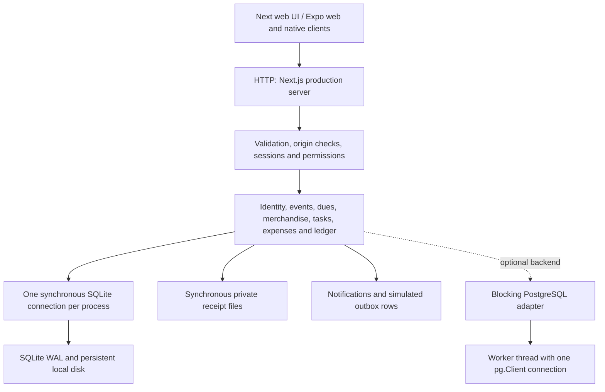

# Local stress test — 11 October 2026

**Provisional operating target: about 15,000 requests/minute for the tested authenticated read/write mix with 1,000 members.** The server completed all 15,180 requests in the one-minute sustained run, with p95 latency of 19.31 ms. Observed maximum throughput was 23,411 RPM, but that concurrency level missed the 500 ms p95 target. This is a measured local workload limit, not one universal capacity number for every endpoint.

The main run measured **133,855 requests across 26 stages**, approximately 06:11–06:20 IST. Separate concurrent business checks finished at 06:21 IST. Application behavior was not modified to improve the results.

## Results that matter

| Workload | Successful requests/minute | p95 latency | Interpretation |
|---|---:|---:|---|
| Mixed workload, sustained for 60 seconds | 15,177 normalized; 15,180 total completed | 19 ms | Zero errors or drops; recommended provisional operating region |
| Mixed workload, 292 requests/sec offered for 30 seconds | 17,517 | 19 ms | Zero errors or drops; higher short-duration load verified |
| Mixed workload, 390 requests/sec offered for 30 seconds | 23,017 | 441 ms | Near saturation; completed less than the offered rate and needed queue drain |
| Mixed workload, 256 simultaneous requests | 23,411 | 681 ms | Highest observed throughput; fails latency target |
| Overload, 585 requests/sec offered | 20,577 | 2,036 ms | 37.34% of offered work failed or was dropped by the generator |
| Dashboard, 1,000 members, concurrency 8 | 9,498 | 68 ms | About 292 KB per response |
| Dashboard, 10,000 members, concurrency 8 | 1,235 | 467 ms | About 2.51 MB per response; close to latency limit |
| Dashboard, 10,000 members, concurrency 32 | 1,516 | 1,388 ms | Higher throughput, unacceptable queueing |
| Successful login, concurrency 1 | 1,739 | 53 ms | Password hashing dominates |
| Successful login, concurrency 32 | 1,718 | 2,081 ms | More concurrency does not increase throughput |
| 90% dashboard / 10% successful login, concurrency 32 | 6,244 | 494 ms | Near the latency limit; a different workload from the main mixed test |
| Initial `/` HTML, concurrency 16 | 28,150 | 44 ms | HTML only; excludes assets, hydration and follow-up API requests |
| Health check, concurrency 32 | 62,503 | 46 ms | Lightweight control; not business capacity |

RPM is successful completions divided by elapsed time, including final queue drain, multiplied by 60. Most stages ran for 15 or 30 seconds: their RPM is normalized, not a full-minute observation. The sustained stage ran for 60 seconds. p95 means 95% of measured requests completed within this duration.

## How much buffer is available?

- **Throughput reserve:** 253 RPS sustained versus 390.19 RPS observed maximum is about **35% below the measured throughput ceiling**, a difference of roughly **8,230 RPM**. Moving from 253 to 390 RPS would be a 54% increase over that baseline, but the ceiling itself failed the latency target. This is a planning margin, not a promise that the extra traffic remains fast.
- **Verified short-duration margin:** the 292 RPS test was 15.4% above the 253 RPS sustained rate and remained fast for 30 seconds. The higher 390 RPS run used about 100% of one CPU core and accumulated a queue; do not use it as the normal operating target.
- **Concurrent requests:** mixed traffic at concurrency 128 had p95 389 ms; at 256 it reached 681 ms. These are simultaneous in-flight HTTP requests, not logged-in users. Think time and API calls per user determine user capacity.
- **Queue limit:** the 512-request cap belongs to the load generator. It is not an application queue capacity. No general bounded admission queue or global overload limiter was found in the inspected application paths. SQLite's 5-second busy timeout is a lock wait setting, not request capacity.
- **CPU:** the server process consumed approximately one core at saturation, despite the machine having 20 logical CPUs. Synchronous work blocks request progress. The 253 RPS sustained stage averaged 76% of one core; process CPU can exceed 100% because runtime helper threads also use CPU.
- **Memory:** maximum sampled server RSS was about 468 MiB. The machine had 15.43 GiB total RAM but only 0.99 GiB free when the run started. There is limited host memory slack under the current desktop workload; unused logical CPU count does not imply equivalent application capacity.
- **Storage:** after growth and load, the main SQLite file was 10.18 MiB, with 17,209 audit rows and 1,607 sessions. This excludes separate WAL, receipts and log files. Retention and storage growth were not soak-tested.

These figures do not measure the existing server's live traffic. Actual live headroom requires measuring its arrival rate and endpoint mix. A one-minute sustained test is also not an hours-long reliability guarantee.

## Test setup and methodology

- Windows 10.0.26300, Intel Core Ultra 7 255HX, 20 logical CPUs, 15.43 GiB RAM; existing desktop applications remained running.
- Node **25.8.1**, Next.js **16.4.0**, production `next build` + `next start`. The README recommends Node 24 LTS; these numbers belong to the installed Node 25 runtime and should be rechecked for a Node 24 deployment.
- Commit `deb1438c74641f60ea2931362d97a0904843f76e` plus the local uncommitted working-tree changes included in build `IOCEZwNJfm7DH2miGcvsB`. This is not a pristine-commit benchmark.
- One isolated production server bound to loopback, a new synthetic SQLite database under `.data/stress-*`, and a separate Node HTTP load-generator process on the same machine. Existing club data was not used. Each test server was stopped afterward.
- Main fixture: **1,000 members, 100 events, 200 tasks, 2 products, 3 initial ledger entries**. Growth phase: 10,000 members with the existing workload data retained. This does not simulate a large historical ledger or thousands of active-member notifications.
- Main mix: **40% authenticated admin dashboard reads, 20% event-list reads, 20% task-list reads, 20% task-status writes**. Writes execute real transactions and create audit records. One authenticated admin session and one task record were reused; this includes the largest privileged dashboard response, not a representative distribution of roles or unique users.
- Closed-loop concurrency ramp: each worker issues its next request after the previous response. Open-loop arrival ramp: independently scheduled requests at 195, 292, 390 and 585 RPS; the generator counts overflow drops rather than hiding them. A 5-second absolute request deadline and 512 in-flight cap bound test pressure.
- Open-loop latency starts at the intended scheduled time, so delayed scheduling is included. The raw results also contain wire/request latency and scheduling delay separately. Drops have no latency sample, but are included in the failure percentage.
- Acceptance target chosen for this test: **p95 <500 ms and <1% failures including generator drops**. It is a provisional target, not an existing product SLA. HTTP success means 200/201; correctness assertions are separate.
- Telemetry: server CPU, RSS, heap and event-loop delay, sampled about once a second with a 20 ms histogram resolution. Generator CPU remained well below one core, reducing the likelihood of generator CPU saturation. Sharing the host, Windows scheduling and background memory pressure still affect results.
- No compression was requested by the client. At 253 RPS the mixed responses alone total roughly 33 MB/sec; a real LAN, TLS and mobile clients can impose additional limits. No real network throughput claim is made.

## What happened under overload and after recovery?

At 585 offered RPS for 30 seconds, 17,550 requests were scheduled. Of these, 10,997 succeeded, 231 timed out, 174 encountered connection refusal, and 6,148 were dropped at the generator's safety cap. That is **37.34% unsuccessful offered work**, not a 37.34% HTTP 500 rate. There were no recorded HTTP 500 responses. The exact operating-system cause of connection refusal was not instrumented.

The application continued running without a benchmark-triggered restart. The subsequent 253 RPS sustained stage completed without failures. A later concurrency-one recovery stage achieved 17,992 RPM with p95 7 ms. Thus the observed overload was recoverable, but availability and latency degraded substantially while it lasted.

## Current system design and peak-load tradeoffs



| Decision | Benefit | Cost at peak / evidence | Recommended next step |
|---|---|---|---|
| One synchronous database interface | Simple transaction boundaries and predictable local sequencing | DB work, mapping and serialization block the serving thread. More HTTP concurrency largely adds waiting | Reduce query/payload work first; consider a dedicated bounded DB worker or an asynchronous persistence layer if measured demand requires it |
| SQLite WAL, foreign keys and `BEGIN IMMEDIATE` | Durable local storage and serialized writes; conditional updates and uniqueness protect business invariants | WAL allows database readers/writers to coexist, but does not make this single synchronous connection parallel. Only one writer proceeds at a time | Keep short transactions and a single writable instance for this setup; measure contention before adding writers |
| Whole-dashboard aggregation | Convenient single response with consistent response shape | Loads all members, events, tasks, products, announcements and transactions. Members and financial data are loaded even when the response later hides them from a role. 10x members grew payload 8.6x and severely reduced throughput | Split summary metrics from paginated lists; select only needed columns; avoid retrieving unauthorized collections merely to discard them |
| No-store API responses and repeated dashboard fetches | Fresh data and simple invalidation | Shell fetches dashboard and notifications every minute and on navigation/visibility changes; overview also fetches dashboard. Repeated full reads consume the same backend budget | Share client query state, remove duplicate requests, refresh a small summary endpoint, and use event-driven invalidation or short scoped caching where staleness is acceptable |
| `scryptSync` password hashing | Salted, deliberately expensive password checks | Hashing blocks unrelated requests. Login-only capacity stayed around 26–29/sec, with p95 above 2 seconds at concurrency 32 | Preserve scrypt strength but move hashing to async execution/a bounded worker pool. Keep per-account lockout and add appropriate global/IP admission controls for bursts |
| Transactional ledger and audit records | Business actions and financial records commit atomically; retries can be idempotent | Each write does extra durable work and grows history; large history reads are unbounded | Preserve these guarantees. Add pagination/retention policies and appropriate query indexes rather than removing correctness checks |
| Expired-hold cleanup in request paths | Capacity/stock is refreshed when workflows run | A dashboard read can trigger transactional cleanup when many holds expire together; this burst was not represented by the small ticket dataset | Test an expiry storm; consider bounded background sweeps while retaining transactional checks at booking time |
| Announcement publication fans out inside one transaction | Publication and notification/outbox snapshot are atomic | Performs roughly two inserts per active recipient while holding the transaction. Large fan-out can stall other requests; not load-tested here | Persist publication plus a durable delivery job, then process recipients in bounded batches with idempotency |
| Private receipts on local disk with sync reads/writes | Simple local access control and storage | Up to 5 MB per receipt, synchronous file I/O, separate backup requirements; upload storms were not tested | Use bounded/streamed async I/O or private object storage, and back up receipts with database state |
| PostgreSQL compatibility through a blocking worker bridge | Reuses current domain modules | The main thread still waits with `Atomics.wait`; there is one `pg.Client`, not an async query pool. Switching URLs alone does not establish more throughput, and network round trips can add cost | Benchmark separately. For horizontal scaling, use async pooled transactions and revisit row locks/isolation/read-then-write races before adding instances |
| No general overload admission layer | Less operational machinery for a small local app | Incoming work queues until timeouts/refusals occur. The 585 RPS stage demonstrated that failure mode | Add a bounded concurrency budget, explicit overload responses, client retry backoff/jitter, and latency/queue monitoring |

Relevant code: [database connection](../../src/lib/database.ts), [transactions](../../src/lib/db/core.ts), [dashboard](../../src/lib/modules/dashboard.ts), [identity](../../src/lib/modules/identity.ts), [password hashing](../../src/lib/auth/password.ts), [HTTP caching](../../src/lib/http.ts), [shell polling](../../src/app/app/_components/shell.tsx), [announcements](../../src/lib/modules/announcements.ts), [receipt storage](../../src/lib/modules/workspace.ts), [PostgreSQL bridge](../../src/lib/db/postgres-sync.ts). PostgreSQL multi-instance caveats are also documented in [POSTGRESQL.md](../POSTGRESQL.md).

Priority order: **shrink/paginate the dashboard → remove duplicate client fetches → make password hashing nonblocking with bounded concurrency → add admission control and telemetry → move bulk work off request paths → benchmark a redesigned PostgreSQL path if more capacity is needed.** No throughput multiplier is claimed for these unimplemented changes.

## Business correctness under concurrency

The main run checked payment idempotency and guest-hold limits after stress. A separate fresh-database run added the full seat-capacity check:

| Check | Result |
|---|---|
| 100 simultaneous bookings for a free 20-seat event | Exactly 20 accepted and 80 sold-out conflicts; no excess successful bookings |
| 100 simultaneous paid-guest booking attempts for a 20-seat event | Exactly 3 pending holds accepted, 97 expected conflicts, registered count 3; matches the configured anti-hoarding rule |
| 50 simultaneous confirmations for the same paid ticket | Exactly 1 creation and 49 idempotent successes; exactly 1 ledger row for 15,000 paise |
| SQLite integrity and foreign-key checks | `integrity_check = ok`; no foreign-key violations after both runs |

These checks support the exercised single-process invariants. They do not establish PostgreSQL multi-instance safety, every merchandise/dues/expense workflow, payment-provider behavior, or failure recovery during power loss.

## Reproduce and inspect

From the repository root, using the existing installed dependencies:

```powershell
npm run build
node scripts/stress-local.mjs
```

The runner creates a new synthetic database each time, starts only its own loopback server, records a new results file, and stops that server at completion. Re-running overwrites `local-stress-results.json`; set `STRESS_OUTPUT` to another filename to preserve an earlier run. It never targets the existing port-3000 server. The optional correctness-only run is:

```powershell
$env:STRESS_PROFILE = 'correctness'
$env:STRESS_OUTPUT = 'docs/performance/local-stress-correctness.json'
node scripts/stress-local.mjs
Remove-Item Env:STRESS_PROFILE
Remove-Item Env:STRESS_OUTPUT
```

Artifacts: [main raw results](local-stress-results.json), [business correctness results](local-stress-correctness.json), [runner](../../scripts/stress-local.mjs), [fixture setup](../../scripts/stress-seed.ts), [server telemetry hook](../../scripts/stress-telemetry.cjs). Per-run telemetry and server logs remain under the ignored `.data/stress-*` directories. The final runner includes the additional free-seat assertion exercised by the supplemental run.

Validation: production build passed; TypeScript check passed; main load run and supplemental assertion run exited successfully. The build emitted an existing dynamic-filesystem tracing warning in `database.ts`; that concerns deployment footprint, not a demonstrated local request failure. Full unit-suite execution was not part of this performance run.

Not measured: an hours-long soak, development-mode performance, real LAN/WAN/TLS, full browser journeys/Core Web Vitals, PostgreSQL load, multiple app instances, large receipt upload storms, large announcement fan-out, or production payment/email providers. These are the limits of the reported capacity figures.

## Complete measured stage table

| Stage | Concurrency | Offered RPS | Successful RPM | p95 ms | Fail/drop % | Meets target |
|---|---:|---:|---:|---:|---:|---|
| health | 32 |  | 62,502.76 | 45.63 | 0.00 | True |
| dashboard | 1 |  | 6,786.44 | 11.95 | 0.00 | True |
| dashboard | 8 |  | 9,497.54 | 67.93 | 0.00 | True |
| dashboard | 32 |  | 7,464.50 | 402.46 | 0.00 | True |
| dashboard | 128 |  | 9,293.40 | 1,068.88 | 0.00 | False |
| mixed | 1 |  | 18,806.81 | 6.10 | 0.00 | True |
| mixed | 8 |  | 20,798.01 | 29.64 | 0.00 | True |
| mixed | 32 |  | 22,231.16 | 97.63 | 0.00 | True |
| mixed | 128 |  | 22,443.70 | 389.13 | 0.00 | True |
| mixed | 256 |  | 23,411.12 | 681.44 | 0.00 | False |
| mixed-open-0.5 |  | 195 | 11,697.38 | 14.92 | 0.00 | True |
| mixed-open-0.75 |  | 292 | 17,516.79 | 18.78 | 0.00 | True |
| mixed-open-1 |  | 390 | 23,016.98 | 440.60 | 0.00 | True |
| mixed-open-1.5 |  | 585 | 20,576.62 | 2,036.37 | 37.34 | False |
| mixed-sustained-65pct |  | 253 | 15,177.13 | 19.31 | 0.00 | True |
| page | 1 |  | 22,349.93 | 4.25 | 0.00 | True |
| page | 16 |  | 28,150.09 | 43.55 | 0.00 | True |
| page | 64 |  | 27,635.10 | 172.04 | 0.00 | True |
| login | 1 |  | 1,739.45 | 53.45 | 0.00 | True |
| login | 8 |  | 1,558.06 | 421.10 | 0.00 | True |
| login | 32 |  | 1,718.13 | 2,080.70 | 0.00 | False |
| loginMixed | 32 |  | 6,244.24 | 493.91 | 0.00 | True |
| recovery | 1 |  | 17,991.88 | 7.00 | 0.00 | True |
| dashboard-10000-members | 1 |  | 1,122.06 | 71.82 | 0.00 | True |
| dashboard-10000-members | 8 |  | 1,235.00 | 467.49 | 0.00 | True |
| dashboard-10000-members | 32 |  | 1,516.37 | 1,388.08 | 0.00 | False |
