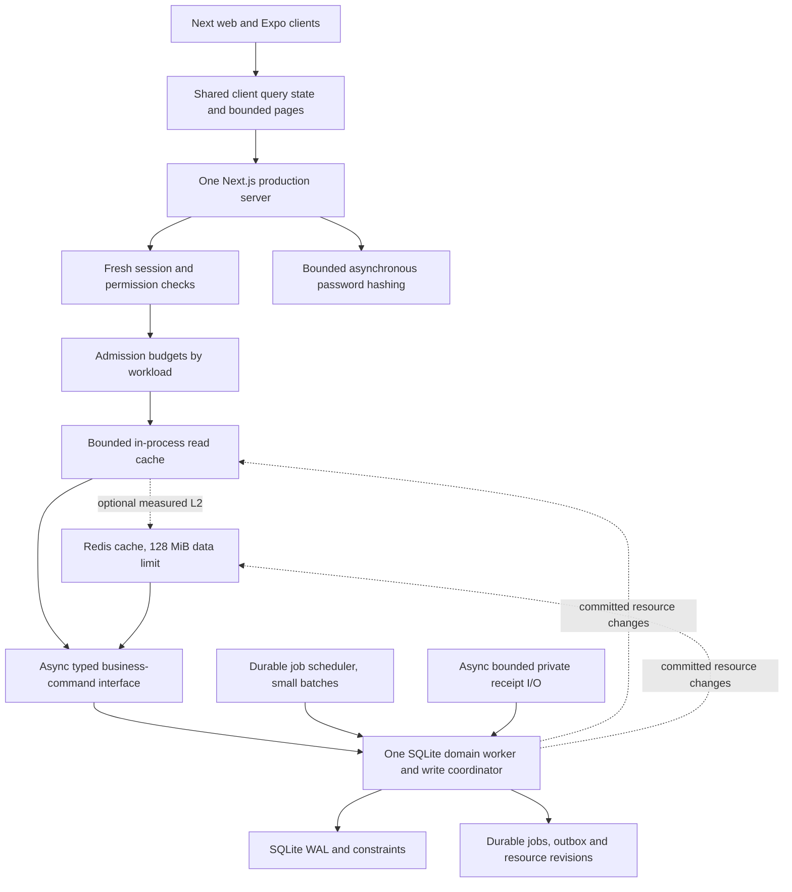

# MODE performance optimization plan

Date: 11 October 2026. Priority chosen by the user: **local laptop first, with a path to hosted scaling**.

Status: active implementation plan, based on the measured local benchmark and current source. The first optimization slice described below is implemented and measured. **Live Odoo GitHub source verification remains blocked** by the automatic approval service returning HTTP 404 for its configured API deployment, including a retry explicitly requested by the user. The Odoo section distinguishes background knowledge from the repository inspection still required.

Implementation update, 11 October 2026: the first P1 slice is implemented. The persistent shell now reads `/api/workspace/summary`, workspace search is bounded and on demand, identical overlapping client GETs are coalesced, and unauthorized dashboard reads no longer materialize member/finance/task collections merely to discard them. See the [comparison and manual test guide](SUMMARY-OPTIMIZATION-COMPARISON.md); raw measurements are in [local-summary-optimization.json](local-summary-optimization.json).

| First-slice result | Before | After |
|---|---:|---:|
| 1,000-member shell payload | 291,653 bytes from full dashboard | 132 bytes from summary |
| 1,000-member concurrency-8 throughput | 8,287 RPM, p95 74 ms | 57,281 RPM, p95 13 ms |
| 10,000-member concurrency-32 throughput | 1,516 RPM, p95 1,388 ms (earlier baseline run) | 47,804 RPM, p95 53 ms |

The response reduction is about 99.95% for the measured shell refresh. This comparison demonstrates the new summary path, not whole-system peak capacity: the overview still uses the legacy full dashboard, search has a different workload, and Redis, pagination, async hashing and admission control remain unimplemented.

The focused [rate limiting and overload queue plan](RATE-LIMIT-QUEUE-PLAN.md) defines route budgets, 429 versus 503 behavior, bounded DB/hash/upload queues, durable-job handling, mass-login edge cases and the local-to-Redis rollout path.

## 1. Outcome and constraints

Make the normal workload cheaper before increasing concurrency. Preserve correct payments, bookings, inventory, authorization and client compatibility. Establish a repeatable sustainable capacity number, including cold caches and failures, instead of maximizing a short cached-read result.

Measured baseline: [stress report](LOCAL-STRESS-2026-10-11.md) and [raw results](local-stress-results.json).

| Baseline | Result | Implication |
|---|---|---|
| 1,000-member mixed workload, 20% transactional task writes | 253 requests/sec for 60 seconds; p95 19 ms, zero failures | Preserve this operating region through every phase |
| Highest observed mixed throughput | 390 requests/sec; p95 681 ms at concurrency 256 | More queued requests are not equivalent to more usable capacity |
| 585 offered requests/sec | 37.34% failed or generator-dropped; p95 2 seconds | Explicit admission control and bounded queues are needed |
| Dashboard, 10,000 members | 2.51 MB per response; 1,235 RPM at p95 467 ms | Pagination, field selection and summaries have priority over Redis |
| Login | About 26–29/sec; p95 2 seconds at concurrency 32 | Move expensive hashing off the serving thread without reducing its strength |
| Laptop | 20 logical CPUs, 15.43 GiB RAM, about 0.99 GiB free at test start | Use a small measured worker budget; do not size workers from CPU count alone |

Proposed acceptance goals, **not predictions or achieved results**:

1. Updated summary response at 10,000 members: at most 20 KiB; normal paginated directory page at most 64 KiB. No directory or entire ledger in the summary.
2. Regression gate: 253 RPS for 30 minutes, p95 below 100 ms, p99 below 250 ms, and under 0.1% unexpected failures. Use the original fixture and a separately reported updated-client workload.
3. Stretch gate: 585 RPS / 35,100 RPM for 10 minutes, p95 below 250 ms, p99 below 1 second, under 0.1% unexpected failures, with 20% real writes. Attempt on both 1,000- and 10,000-member fixtures; publish any target missed rather than tuning the workload silently.
4. Overload gate: at twice the newly measured sustainable rate, bounded waiting and prompt 429/503 responses; no unbounded memory growth or financial inconsistency; recovery within 10 seconds of reducing the offered load. Intentional overload rejection remains separately counted and is not successful business throughput.
5. Resource planning budget: start with total application/worker RSS below 1 GiB, excluding the optional PostgreSQL service; Redis cache capped separately. Measure actual memory, including hashing, query buffers, IPC copies and Redis overhead. Do not claim these limits have already been met.

## 2. Proposed laptop architecture

This is an incremental destination, not the first patch. Initial payload and client-cache changes can retain the current synchronous database. Move whole domain commands to a database worker when ready; never interleave SQL from different requests inside the same open transaction. The worker keeps the existing synchronous transaction semantics internally while the HTTP process awaits results asynchronously.

The local default remains one web process and one database coordinator. A job scheduler routes local database work through that coordinator. Multiple SQLite-writing web/job processes are not the default scaling strategy. Independent read connections are a later experiment, requiring measured benefit and explicit snapshot/checkpoint behavior.

## 3. Delivery sequence

Each row is a separate reviewable change, with measurements saved before moving on. Branch and PR names should describe the work without agent/provider prefixes.

| Phase | Concrete implementation | Main files / additions | Exit gate |
|---|---|---|---|
| P0: trustworthy baseline | Use Node 24 LTS for the intended deployment, rerun baseline, add per-route duration, response bytes, SQL timing/counts, event-loop lag, hash queue and resource measurements | `scripts/stress-local.mjs`, `scripts/stress-telemetry.cjs`, `src/lib/http.ts`; proposed telemetry module | Record repeatable cold/warm results, build/runtime/fixture IDs and background host load; distinguish server rejection from generator drops |
| P1: bounded data and fewer requests | Add summary and paginated APIs; SQL aggregation/projections; targeted indexes; migrate clients; remove duplicate dashboard polling | `src/lib/modules/dashboard.ts`, `identity.ts`, `workspace.ts`, ledger queries, API routes, contracts, both clients | Payload budgets met at 10k members; no missing records; original API compatibility tests pass |
| P2: safe caching | Add client query sharing, bounded server read cache, single-flight misses, TTL limits and post-commit invalidation | Proposed `src/lib/cache/*`; `db/core.ts`; domain mutation hooks; web/Expo query providers | Permission/tenant separation, rollback, stale-repopulation and read-after-write tests pass; hit rate and bytes saved reported |
| P3: responsive server | Async bounded hashing; typed async domain facade; one SQLite worker; per-workload admission control and deadlines | `auth/password.ts`, `modules/identity.ts`, auth routes, `database.ts`, authorization helpers; proposed worker/facade modules | Login pressure no longer stalls unrelated reads; transaction behavior survives concurrency, worker failure and request cancellation |
| P4: Redis comparison | Add optional Redis cache adapter and local compose profile, fixed resource budget, outage fallback and instrumentation | Proposed Redis adapter and `docker-compose.performance.yml`; environment example only when implementing | Same workload compared with no cache, L1, and L1+Redis; keep Redis optional unless it measurably helps |
| P5: background and I/O | Durable jobs/outbox, batched expiry/retention, asynchronous receipt I/O and paginated/streamed exports | Migrations, announcements, dues, events, merchandise, workspace; proposed job runner | Worker restart/retry and expiry storms preserve business invariants; interactive p95 remains within target |
| P6: peak validation | Sustained, overload, cold-cache, mutation churn, login burst and dependency-failure matrix | Extend load runner and focused integration tests | Publish new sustainable RPM, p95/p99, error types, resource footprint and headroom; no unsupported speedup claim |
| P7: hosted profile | Native async PostgreSQL repositories and transaction API, pool limits, shared cache coordination, durable workers, private file storage and reverse proxy | Replace blocking PostgreSQL bridge behind a tested async facade; deployment configuration | Multi-process race tests pass before adding a second web instance; complete backup/restore and rollback rehearsal |

Dependencies: P0 → P1 → P2. Hash isolation in P3 can follow P1, but the DB worker/facade needs all relevant routes to await it. P4 follows the cache abstraction. P5 uses the same coordinator and invalidation rules. P7 is gated by the need for more capacity or hosted durability, not required to finish the laptop profile.

## 4. Payloads, SQL and client changes

### API contracts

- Add `GET /api/dashboard/summary`: club identity, bounded count metrics and explicitly bounded previews where needed. Separate finance data behind its existing permission and live ledger endpoint. Do not call `getMembers()` merely to compute a count.
- Add versioned collection endpoints, initially `/api/v2/members`, `/api/v2/tasks`, `/api/v2/events`, `/api/v2/ledger/entries`, returning `{ items, nextCursor, hasMore }`. Default page size 25, maximum 100. The version avoids silently changing the old array shapes or truncating existing clients.
- Use keyset cursors with a deterministic final `id` tie-breaker. Bind/validate cursor versions, filter/sort parameters and club scope. Still derive authorization and club from the session; a cursor grants no access. Define null ordering for legacy nullable task timestamps before indexing or backfilling them.
- Member directory ordering: `(joined_at DESC, id DESC)` unless product requirements need alphabetical ordering; declare the sort explicitly. Ledger ordering: `(occurred_at DESC, id DESC)`. Handle inserts/deletes during pagination without duplicate rows in the stable ordering; document that mutable filters do not provide a frozen export snapshot.
- Keep existing `/api/dashboard` and collection endpoints functioning during migration. Update the current web workspace, root/legacy surfaces and Expo client. Regenerate `client/src/generated/contracts.ts` with `npm run sync:contracts`, and update API/schema docs and contract checks. Measure legacy endpoints separately until their clients have migrated.
- Add a dedicated notification unread count instead of retrieving all notifications just to count unread rows. Review every summary field against the caller's permissions before querying it.

### Database work

- Use SQL `COUNT`, selected columns, bounded `ORDER BY … LIMIT`, batched queries and cached prepared statements tied to a connection/schema lifetime. Never interpolate user input into SQL or maintain an unlimited cache of arbitrary query strings.
- Candidate indexes, to accept only after `EXPLAIN QUERY PLAN` and write-cost measurements: members `(club_id, joined_at DESC, id DESC)`; tasks `(club_id, status, created_at DESC, id DESC)` or assignee variant based on measured filters; transactions `(club_id, occurred_at DESC, id DESC)` and `(club_id, event_id)` when event finance queries justify it.
- Inspect existing indexes first. Current code already has membership-expiry, event, task-club, ticket-hold and merchandise-hold indexes; avoid redundant indexes and their extra write cost.
- Do not disable WAL durability, foreign keys, unique payment/source constraints or inventory checks for a faster benchmark. Profile checkpoint time and WAL growth under readers; preserve normal automatic checkpoints before attempting tuning.
- Only introduce maintained ledger/counter projections if aggregate queries remain expensive on a realistically large history. Update projections in the same transaction as their source changes and reconcile them against the authoritative records.

### Client work

- Adopt a shared query library such as TanStack Query for the Next and Expo clients, with versions checked for each client's React/React Native compatibility during implementation. This is a proposed dependency, not yet installed.
- Key client data by club, user/security scope, filters and API version. Clear private cached data and in-flight requests on logout, account switch and permission changes. Do not persist sensitive queries in browser storage by default.
- Make shell and overview subscribe to the same summary query. Refresh small data, not the full dashboard. Coalesce focus/navigation refreshes; disable hidden-tab polling; add jitter when polling is still needed.
- Set short stale windows per query rather than treating every read as immutable. Use mutation responses to update the initiating client's view and invalidate dependent summaries. Financial/booking success must come from the server; reconcile ambiguous timeouts using idempotency keys/status reads rather than repeating an unkeyed mutation.
- Virtualize large rendered lists where profiling shows DOM/React cost. Pagination remains necessary even if a list is virtualized. Lazy-load scanner, charts and other heavy feature code; do not turn the API benchmark into a claim about browser responsiveness.

## 5. Cache policy and invalidation

Start with an explicit cache abstraction around sanitized read models, not a global cache wrapped around route handlers. Continue checking authentication and permissions on every request. Start L1 with **32 MiB byte budget**, an entry-count cap and **64 KiB per-entry cap**; values above the cap bypass caching. These are tuning starting points, not measured optima.

| Data | Proposed cache | Freshness and key scope | Invalidation / consistency |
|---|---|---|---|
| Public club metadata | L1; optional Redis | 60-second hard expiry, club + locale + schema version | Club update evicts; no private fields |
| Nonfinancial summary | L1; optional Redis | About 3 seconds, hard maximum 5 seconds; club + effective permission projection + locale/date as relevant | Member/dues/event/task changes invalidate affected resources; cap lifetime at calendar/event transitions |
| Published announcement/catalog metadata | L1; optional Redis | 15–30 seconds; club + visibility scope + normalized bounded page/filter | Publish/edit/archive/product changes invalidate; live stock and eligibility are separate |
| Member/task pages and user notifications | Client request deduplication first | Server caching off initially; authorized bounded live queries | Mutation invalidation in client; add server caching only if reuse is demonstrated and user scope is complete |
| Availability displayed in lists | Optional short-lived display cache | At most a few seconds, explicitly advisory | Booking/order decisions always recheck in the DB transaction |
| Sessions, roles, membership eligibility, payment confirmation, final stock/seat allocation | No server response cache in initial design | Fresh DB authority | Preserve immediate revocation, price/eligibility and invariant checks |
| Ledger/export and private receipts | No shared response cache | Fresh authorized reads; private/no-store HTTP policy | Object/file access always authorized; exports must define consistency/snapshot semantics |
| Fingerprinted JS/CSS/public assets | Browser/static-file caching | Immutable only for content-addressed files | New file hash per deployment |

Example logical key: `mode:<environment>:<payload-version>:<club>:<resource>:<permission-projection>:<locale>:<filter-digest>:<resource-generation>`. Member-specific data additionally includes member scope. Never include raw passwords, session tokens, receipt credentials or raw personal data in keys/logs. Permission grouping is valid only for data identical for every member of that group.

Required protocol:

1. Validate request and resolve current actor before any private cache lookup. Build an authorized projection, not a cached admin result later handed to a less-privileged caller.
2. A mutation records affected resource tags in its transaction context. Inner savepoint success merges tags into the parent; rollback discards its tags. Only the outer successful commit publishes invalidation.
3. On the single-process path, increment resource generations and evict synchronously after commit and before returning/awaiting another operation. A read miss captures its generation and may publish only if that generation still matches after computation. This prevents a slow old read repopulating the cache after a write.
4. Separate post-commit failure handling from transaction rollback handling. A Redis failure after a committed payment must not cause the code to attempt rollback or report an ordinary uncommitted failure. Return the committed result; disable/bypass affected cache state and record retryable invalidation work.
5. With Redis/multiple processes, keep resource revisions and an invalidation event in the SQL transaction. Deliver durable invalidation events with retries; coordinate generation updates/cache fills atomically, such as a compare-and-set Redis script. Pub/Sub can wake consumers, but is not the durable record.
6. Redis/L1 entries carry an absolute creation/expiry deadline and generation. L1 never extends a value's remaining L2 lifetime. A missed invalidation can cause only the declared bounded staleness of eligible display data; data requiring stronger guarantees bypasses the cache or checks a DB revision.
7. Deduplicate simultaneous misses by key (single flight); bound waiters and computation concurrency. Distributed refill locks require an owner token, expiry and compare-and-delete release. If the lock or Redis is unavailable, use a bounded fallback, not unlimited parallel DB refills.
8. TTL jitter must stay inside the promised maximum age. Membership state changes at Asia/Kolkata midnight and events/holds change with time even without a write; include a date/time boundary or clip expiry accordingly. Do not serve stale finance/auth values using stale-while-revalidate.

### Next.js 16.4 integration

The installed guides were read for this plan. `use cache` and `use cache: remote` require `cacheComponents`; their functions are async and cannot directly read request cookies/headers. Read request identity outside a cached scope and pass explicit safe values. `use cache: private` is not a shared server cache.

For the first API improvements, use the application read-cache abstraction; do not simultaneously add a second overlapping Next data cache. Later use Cache Components where it helps server-rendered shells. Merely writing `use cache: remote` does **not** install Redis: the installed `cacheHandlers` guide says the default handler is in-memory if no custom handler is configured. `cacheHandlers` for Cache Components and the older singular `cacheHandler` API are distinct integrations.

`revalidateTag(tag)` without a second argument is deprecated in the installed guide. `revalidateTag(tag, 'max')` allows stale responses; do not use that as an immediate-consistency mechanism. Hosted instances also need coordinated tag state, including `refreshTags()` if using a custom Cache Components handler. Do not cache private HTTP responses at a public proxy/CDN.

## 6. Redis: exact role and operating rules

**Redis is optional for the laptop; it is a measured shared-cache option for hosted deployment.** A bounded memory cache can outperform an additional network round trip for fast local SQLite reads. Cache-hit ratio, avoided SQL work, p95 and memory decide whether Redis earns a place.

Local experiment:

- Add a separate compose profile, bound to loopback, using a reviewed supported Redis release pinned during implementation. Do not repurpose or overwrite the existing PostgreSQL volume/configuration.
- Cache instance starts at `maxmemory 128mb` with `allkeys-lfu`. Budget container/process overhead beyond this data limit. Cached values are disposable: cache-only persistence may be disabled; database and receipt durability are unaffected.
- L1 remains capped at 32 MiB. Compare L1-only against L1+Redis with identical cold/warm workloads and eviction pressure. Report cache size, hit ratio, refill count, invalidation latency and source query work.
- Initial Redis operation budget: 20 ms, with a circuit breaker after repeated errors and jittered recovery probes. Treat these as testable configuration values. Cap pending commands; avoid an unbounded offline command queue during an outage.
- On cache failure, degrade to bounded database reads. If the DB queue is full, return a prompt overload response; cache outage must not create a retry storm. Avoid clearing the entire database/cache using wildcard scans in request paths.

Hosted roles:

- Redis can share sanitized read models, aggregate rate-limit counters and transient invalidation notifications. It does not replace PostgreSQL for payments, stock, sessions or the durable outbox in this plan.
- Do not store a durable job queue or correctness-sensitive limiter state in the same eviction-prone cache instance. Separate memory policy/instance boundaries are needed; Redis logical DB numbers do not isolate eviction policy.
- Default durable job option is the SQL jobs/outbox table. BullMQ is an alternative only if advanced workflow scheduling justifies it. If selected, use a separate no-eviction Redis service with persistence and failure recovery, plus SQL idempotency/outbox reconciliation. Redis job delivery is not exactly-once business execution.
- Shared limiter outage policy must be explicit. Local mode uses bounded in-process limits plus durable per-account lockout. Hosted mode uses conservative per-instance fallback budgets based on instance count; never silently multiply the global login budget across instances or treat an evicted counter as unlimited capacity.

## 7. Hashing, workers and overload control

### Password flow

Use asynchronous `crypto.scrypt` with an explicit semaphore first, preserving salt, cost parameters, key length, hash format, timing-safe comparison and unknown-account dummy work. Start with **2 hash operations at once**, **16 queued**, and a **100 ms maximum queue wait**, then test 2 versus 4 against memory and latency. Do not increase the libuv pool merely to use all logical CPUs.

Do not hold a SQL transaction or SQLite write lock while awaiting hashing. Login becomes: read credential/version and lockout state → hash outside the transaction → in a short transaction recheck credential/version and current lockout before issuing a session or recording a failed attempt. Password change/reset during hashing must invalidate the old verification. Registration hashes before its short insert transaction; uniqueness remains enforced in the database. Credential helpers, login/register/change/reset routes and their tests must migrate together.

Async hashing may still compete with file work in the shared libuv pool. Profile that interaction; use dedicated hash workers only if isolation is necessary. Hashing is not moved into the single SQLite worker, which would recreate the same bottleneck there.

### Database worker

Expose typed business commands and read models rather than a publicly selectable arbitrary SQL command. A command owns its full transaction and receives validated server-side arguments. Return committed resource-change metadata with the result so the cache coordinator invalidates correctly. Authorization must remain current; for critical mutations recheck actor/permissions inside the transaction rather than trusting an earlier actor snapshot across an async queue wait.

Use readiness, bounded queue depth, per-command duration metrics and fail-fast worker health. A cancelled HTTP request can be removed if still queued; a transaction already committed cannot be undone by request cancellation. Use operation IDs/idempotency and result lookup for ambiguous client timeouts. Graceful shutdown stops new work and drains or rejects queued work explicitly.

### Admission budgets

Start with a global HTTP in-flight cap of 128, a bounded DB-command queue of 64 with a 100 ms queue-wait budget, the separate hash budget above, and at most 2 large receipt uploads. These are starting configurations to tune, not capacities established by the previous test. Apply body-size checks before expensive buffering and measure all memory copies.

Distinguish 429 for per-client/account rate policy from 503 for exhausted server capacity. Send `Retry-After`; clients use capped exponential backoff with jitter. Automatically retry reads only within a deadline; retry mutations only with an implemented idempotency contract. Keep lightweight liveness separate from readiness/DB health so health probes do not add substantial work to an overloaded queue. Any trusted proxy/IP extraction must be configured explicitly before IP-based limits.

## 8. Background jobs, receipts and retention

Add an additive migration for durable jobs and, where needed, cache invalidation events/resource revisions. Fields include job kind, scoped entity ID, deduplication key, status, attempts, next-run time, lease owner/deadline, last safe error and timestamps. Use unique dedupe keys, bounded retries/backoff, recoverable leases and a dead-letter/manual retry state. Do not expose sensitive payloads in logs.

Local scheduler reads due work and submits short commands to the same DB coordinator. Give interactive commands priority while reserving a small bounded share for maintenance to avoid starvation. Hosted PostgreSQL workers can claim work with `FOR UPDATE SKIP LOCKED`, with retry-safe effects and lease recovery.

- **Expiry:** sweep ticket/order holds in bounded batches, with indexed eligibility checks. Booking still checks authoritative capacity/stock in its transaction. Summary reads should not perform an unbounded expiry sweep. Sleep/resume and clock jumps must not lose due work.
- **Announcements:** current contract atomically creates the publication, recipient snapshot, notifications and simulated outbox rows. Moving this to background work changes visible semantics. Use a versioned contract with publication state and delivery progress, or preserve the old synchronous endpoint until migration. Capture eligible recipient IDs/emails with a set-based durable snapshot in the publication transaction; do not reevaluate membership separately on each retry. Fan-out batches use existing recipient uniqueness guarantees. If notifications must appear immediately, insert them in a set-based transaction and defer only delivery work.
- **Email/payment providers:** existing delivery is simulated and confirmations record external payment references. Background optimization does not authorize sending real email or performing transfers. A future provider integration requires its own contract, idempotency and authorization.
- **Receipts:** stream within the existing 5 MB limit where the runtime allows; write a private temporary file, validate, atomically finalize, then attach metadata with compensating orphan cleanup. File and SQL transactions are not one atomic operation; test crashes at each boundary. Back up receipts and database together. Hosted profile uses private object storage and short-lived authorized downloads.
- **Exports:** paginate/stream small exports, and job large exports. Define a cutoff or database snapshot so a running financial export does not silently mix states. Keep slow client downloads from holding long write-blocking transactions.
- **Retention:** schedule existing session/login/outbox purge logic in small batches. Financial/audit retention requires an explicit policy; never silently delete ledger/audit history merely to keep a benchmark fast.

## 9. Hosted scaling path

Reuse the async domain facade, then implement native asynchronous PostgreSQL repositories with a dedicated transaction client per operation. Remove the current `Atomics.wait`/single-`pg.Client` bridge from the hosted hot path. A URL switch alone is not the optimization.

1. Start with one app instance and a small pool, initially 5 connections, then measure. Budget all app pools, jobs, migrations and administration against PostgreSQL's connection limit. Configure acquisition, statement and lock timeouts. Add PgBouncer only if connection behavior warrants it and its transaction-pooling constraints have been checked.
2. Audit read-then-write invariants before a second instance: guest pending quotas, per-member pending merchandise totals, credential failure counters, renewal state, stock/capacity and payment idempotency. Use consistent row-lock ordering or a suitable isolation strategy and whole-transaction retries. Conditional updates and unique constraints remain backstops; `BEGIN` is not cross-process SQLite `BEGIN IMMEDIATE`.
3. Shared cache generations/invalidation, SQL-backed sessions, durable jobs and shared private receipt storage must work across instances. Do not rely on sticky sessions or process-local cache eviction for correctness.
4. Add a reverse proxy for TLS, request/body/time limits, gzip/Brotli for suitable responses, and immutable static assets. Compression is a measured network/CPU tradeoff and does not replace smaller JSON. Preserve Next streaming behavior and origin/cookie security. Public CDN caching is limited to explicitly public content/assets.
5. Use the same app build across instances; configure deployment/version coordination and Server Action encryption keys if Server Actions are used. Rolling deployments need compatible contracts/cache namespaces and additive migrations.
6. Scale on latency, queue time, error rate and memory, not CPU alone. Test loss of one instance, Redis outage, PostgreSQL slowness and job replay. Prove restore from database and receipt backups before relying on hosted persistence.

## 10. Odoo repository comparison: what is known and what remains to verify

**No current Odoo repository contents were retrieved in this session.** Shell network access was denied and the supported browser's GitHub action failed automatic approval with the configured API deployment's 404, including the user-requested retry. Links below are inspection targets, not citations to inspected code. There are no invented commit hashes or claims of a completed source audit.

Architectural background from general prior knowledge, requiring version-specific verification: Odoo has historically emphasized PostgreSQL, ORM prefetch/batching, process-local method/record caching, deployment worker processes and scheduled jobs. Community queue modules are distinct from Odoo core. That background does **not** establish that current Odoo core uses Redis as its default cache or job backend.

| Repository / inspection target | What to verify on a pinned supported release | MODE decision it informs |
|---|---|---|
| [odoo/odoo](https://github.com/odoo/odoo): ORM/model/environment code | Prefetch, batched reads/writes, aggregate queries and invalidation across writes | Smaller bounded queries and fewer repeated DB round trips |
| `odoo/odoo`: cache/LRU and registry signaling code; historically `odoo/tools/cache.py`, `lru.py`, registry modules | Scope/key composition, boundedness, transaction invalidation, cross-process propagation | Cache policy and generation protocol; do not equate method cache with safe whole-response caching |
| `odoo/odoo`: SQL connection and server-worker code; historically `odoo/sql_db.py`, `odoo/service/server.py` | Pool sizing, worker lifecycle, time/memory limits, connection accounting and platform constraints | Bounded worker/admission budgets; avoid copying a Python deployment formula into Node |
| `odoo/odoo`: cron, mail and bus modules | Job claims/locks/batching, retry behavior, recipient snapshot/delivery, notification transport | Durable jobs/outbox and bounded background work; notifications are not durable business state |
| [odoo/documentation](https://github.com/odoo/documentation) | Performance and deployment recommendations for the same release, including proxy/static assets and worker limits | Cross-check implementation and deployment guidance |
| [OCA/queue](https://github.com/OCA/queue) | `queue_job` persistence, channels/capacity, retries, transaction boundaries and dependencies | Compare a durable SQL job design with Redis-backed alternatives; label OCA separately from official Odoo core |
| Redis integrations | Search core requirements/imports/config and community repositories; identify ownership and exact version | Establish whether Redis is core, optional or third-party before using Odoo as evidence |

When access works: resolve the selected release branch to a commit, inspect these files and manifests, follow changed file locations instead of assuming historical paths, record commit-pinned line links and short findings, and revise any plan decision contradicted by the source. A claim that Redis is absent requires an appropriately scoped repository search, not failure to find one file. Licensing/reuse must be reviewed before copying code; architectural comparison does not require copying it.

Odoo research is still an open deliverable. It does not block independently justified payload, cache-safety or hashing improvements to MODE, but the completed plan must not be described as Odoo-source-verified until this section has real evidence.

## 11. Validation and rollout

Run focused tests for each semantic change, then the existing appropriate contract/type/schema/unit/build checks. Avoid repeated full stress runs for documentation-only edits. Add integration coverage where concurrency/caching introduces new failure modes:

- Cold/warm cache, concurrent refill, expiry jitter, eviction, resource revision races and rollback/savepoint behavior. Failure after SQL commit must never produce a false rollback.
- Anonymous/member/officer/other-club reads using similar keys; role change, logout and credential reset while a read/hash operation is in flight; no private response sharing.
- Asia/Kolkata midnight, event start, hold expiry, laptop sleep/resume and clock changes.
- 100 simultaneous requests for 20 seats; competing merchandise quota/stock changes; duplicate payments and retries; full ledger/inventory reconciliation.
- Queue saturation, worker crash/restart, cancelled queued requests, ambiguous timeouts after commit and graceful shutdown.
- Redis disconnected, slow, restarted, full/evicting, missed Pub/Sub and delayed invalidation delivery. Correctness survives; fallback stays bounded.
- Background recipient snapshot preserved across membership changes and retries, expiry storms, file write/SQL crash boundaries and export consistency.
- PostgreSQL multi-process race tests are mandatory before hosted horizontal scaling.

Benchmark matrix: 1k and 10k members; current small-history baseline plus a larger history with valid ledger sources; 1%, 10% and 20% writes; 0%, 10% and burst login traffic; cold/warm caches, high mutation churn and unique-query misses. Use real user-role distributions and many keys alongside the repeatable shared-key workload. A cache hit rate from one reused admin session must not be generalized to all users.

Keep the original workload and legacy endpoint results. Add a separately named updated-client scenario using the new summary/pages, with equivalent logical screen/actions. Report requests per user journey and completed business actions as well as RPM so splitting one API into several does not look like a performance gain by itself. Run HTTP-only and browser/network tests separately.

Store build/runtime/fixture IDs, all offered/completed/rejected/dropped counts, latency from intended arrival time, p50/p95/p99/max, request/body bytes, SQL and queue time, CPU/memory per process, WAL size, cache hit/miss/eviction/invalidation delay and job lag. Use three repetitions of decisive capacity points; no claimed linear worker multiplier. Sustainable capacity is the highest rate meeting the full duration/error/latency/resource gates, not the highest short-run RPM. Recompute a 30–35% operating margin from that newly measured sustainable capacity.

Rollout and rollback: additive APIs and migrations first; feature flags for cache backend, client summary adoption, hashing/worker path and scheduler. Keep legacy endpoints until supported clients migrate. On cache anomalies, disable cache and retain admission limits. On scheduler issues, pause claims and preserve queued rows. Stop/drain the database coordinator before switching ownership; never run old and new writers against the same SQLite file accidentally. Do not dual-execute writes for shadow comparison. Back up before migrations; roll back through compatible app versions instead of destructive schema reversal.

## 12. Evidence and completion status

Verified local inputs: current MODE modules/routes/schema/contracts; the stress artifacts linked above; installed Next.js 16.4 guides for `use cache`, `use cache: remote`, `cacheHandlers`, `revalidateTag` and self-hosting under `node_modules/next/dist/docs/`.

Completed in this planning pass: laptop-first architecture, phased changes, cache policy/invalidation, Redis resource/failure policy, hashing/worker design, durable-job and file-I/O plan, hosted migration conditions, acceptance tests and rollout/rollback strategy.

Pending: live Odoo/OCA repository verification; actual implementation; rebenchmarking the optimized system. The proposed RPM and memory targets are not measured optimized results.
