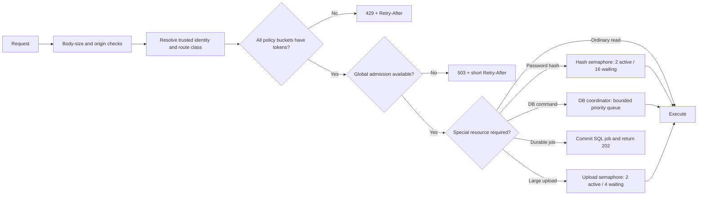

# Rate limiting and overload queue plan

Date: 11 October 2026  
Target: 1,000-member local laptop first, with a compatible Redis/PostgreSQL path for hosted scaling.  
Status: Phase A started. The bounded local token-bucket store, global 64/128 HTTP admission gate, summary/search/login policies, overload response headers and bounded web GET retries are implemented. Resource-specific DB/hash/upload queues and the hosted Redis backend remain planned. Initial values require mixed-workload and endurance tuning.

## 1. Objectives

The system must remain responsive when many members open the app together, a client retries aggressively, a popular event opens, password hashing saturates, SQLite serializes writes, Redis is unavailable, or a background job backlog grows.

The design separates three different outcomes:

| Outcome | HTTP behavior | Meaning |
|---|---|---|
| Policy limit | `429 Too Many Requests` + `Retry-After` | This identity, club, event or source exceeded its allowed rate. |
| Capacity rejection | `503 Service Unavailable` + `Retry-After` | A bounded server resource is currently full. |
| Accepted asynchronous work | `202 Accepted` + operation ID/status URL | Durable work was stored and may finish after the request. |

Business conflicts continue to use `409`; invalid or oversized bodies continue to use `400`/`413`. A queue must never disguise a business conflict or turn an unaccepted request into an apparently successful one.

## 2. Capacity formulas

For registered members:

```text
offered_rpm = members × active_fraction × requests_per_active_member_per_minute × burst_factor
offered_rps = offered_rpm / 60
```

For a measured resource:

```text
safe_rps = measured_sustainable_rps × operating_fraction
utilization = offered_rps / safe_rps
buffer = 1 - utilization
```

The summary endpoint's efficient measured knee was 64,388 RPM at concurrency 32. Until a longer mixed test exists, use 65% of that point:

```text
summary_safe_rpm ≈ 64,388 × 0.65 ≈ 42,000 RPM
summary_safe_rps ≈ 700 RPS
```

Queue sizing begins with Little's Law:

```text
expected_in_flight = arrival_rps × service_time_seconds
theoretical_queue_slots = resource_rps × maximum_queue_wait_seconds
```

At 700 RPS and 35 ms, expected summary concurrency is about 25. A 100 ms theoretical queue is 70 requests, rounded down to a bounded 64 slots. This does not mean every route shares the summary endpoint's capacity; each expensive resource has its own measured gate.

## 3. Request flow



Order matters. Reject known oversized bodies before expensive parsing, apply policy before consuming scarce resources, authenticate before using account/club keys where possible, and never hold a database transaction while waiting for a hash, upload slot or remote cache call.

## 4. Rate-limit algorithm and keys

Use a token bucket because it permits a controlled burst while enforcing a sustained rate.

An authenticated request must pass every applicable bucket:

```text
route-class + account
route-class + club
optional route-specific resource, such as event or announcement
global emergency budget
```

An anonymous request uses a normalized public-resource key and source IP only after trusted-proxy handling is configured. Never trust arbitrary `X-Forwarded-For`. Direct local traffic uses the socket peer address; hosted traffic accepts forwarded addresses only from configured proxy hops.

Local mode keeps bounded token buckets in process memory with idle-key expiry. This is appropriate only for one app process. Hosted multi-instance mode uses one atomic Redis script, Redis server time and expiring keys so all applicable buckets are checked and consumed together. If Redis fails, a small local emergency limiter remains active and the circuit breaker prevents every request from waiting on Redis.

Rate-limit state is ephemeral. Payment idempotency, stock, sessions, login lockouts and durable job state remain in SQL.

## 5. Initial route policies

These are starting values, not proven capacities. `Burst` is the maximum immediately available token balance.

| Route class | Account/source rate | Club/resource rate | Burst | Notes |
|---|---:|---:|---:|---|
| Workspace summary | 30/min/account | 42,000/min/club | 5/account; 700/club | Client should fetch on load/change, not poll continuously. |
| Workspace search | 30/min/account | 3,000/min/club | 6/account; 100/club | Two-character minimum, 180 ms debounce and six-result bound stay in place. Increase only after a search-specific benchmark. |
| Normal authenticated reads | 120/min/account | 12,000/min/club | 20/account; 400/club | Lists must still be paginated and bounded. |
| Ordinary mutations | 30/min/account | 2,000/min/club | 5/account; 50/club | Idempotency keys required where a lost response could cause duplication. |
| Financial/payment mutations | 10/min/account | 300/min/club | 3/account; 10/club | Always synchronous, transactional and idempotent; no blind automatic retry. |
| Guest ticket/order creation | 60/min/IP | 600/min/event or product | 10/IP; 100/resource | Existing inventory and pending-hold constraints remain authoritative. |
| Login | 300/min/IP | 10 failed attempts/15 min/email | 50/IP; 10/email | Successful authentication refunds the email token. Existing five-failure, 15-minute SQL lock remains authoritative. The hash semaphore is the main CPU gate. |
| Receipt upload | 10/10 min/account | 50/10 min/club | 2/account; 10/club | Also limited by two active uploads and request-size checks. |
| Health/readiness | 60/min/IP | global 600/min | 10/IP | Liveness remains cheap and independent of DB readiness. |

The club summary bucket intentionally allows the provisional 700 RPS operating target. The per-account bucket prevents one broken client from consuming it. A 1,000-member synchronized launch can still exceed instantaneous admission, so clients add startup jitter and honor overload responses.

## 6. Admission and queue budgets

### Global HTTP admission

- Soft pressure threshold: 64 in-flight requests. Begin shedding anonymous, search and background-triggering traffic first.
- Hard cap: 128 in-flight requests. Reject additional requests promptly with `503` and a short `Retry-After`.
- Do not build an unbounded FIFO in front of the hard cap. The client is a cheaper waiting room than server memory.
- Liveness bypasses the ordinary queue but performs no database work. Readiness reports overloaded/unready when critical queues remain saturated.

### Database coordinator

- One active SQLite command owner.
- Maximum 64 waiting commands.
- Maximum interactive queue wait: 100 ms. Expired queued reads are removed and return `503`.
- Once a transaction starts, request cancellation cannot undo a commit. Mutations with ambiguous client timeouts use idempotency keys and result lookup.
- Weighted scheduling: eight interactive commands, then one maintenance command when both classes are waiting. Financial and inventory commands are interactive but do not bypass their own rate limits.
- Reserve at least four queue slots for short critical mutations so a read burst cannot occupy the entire queue.
- A background task may not split one business transaction into independently interleaved queue items.

### Password hashing

- Two active asynchronous `scrypt` operations.
- Sixteen waiting operations.
- Maximum queue wait: 100 ms for login; return `503` when full without revealing whether an account exists.
- Unknown accounts perform equivalent-cost dummy work when admitted.
- Keep the existing per-email failure lock in SQL. Do not hold a transaction while hashing.

### Receipt uploads

- Two active uploads and four waiting requests.
- Reject declared oversized bodies before multipart parsing; retain the verified byte limit during streaming/parsing.
- Maximum admission wait: one second because uploads are explicit user actions, then return `503`.
- File persistence and database metadata remain one compensating workflow: failed metadata insertion removes the newly written file.

### Durable background jobs

Long work does not stay attached to an HTTP queue. Insert a job/outbox row in the same SQL transaction as the state change and return `202` when the API contract is asynchronous.

- SQL is the default durable job store for local mode.
- Jobs have stable IDs, idempotency keys, type, payload version, status, attempt count, `available_at`, lease owner/expiry and last error.
- A worker claims a bounded batch, executes retry-safe effects, records the result, and recovers expired leases.
- Exponential retry uses jitter and a terminal dead-letter state. Business validation errors are not retried.
- Interactive DB work receives priority, but weighted scheduling guarantees maintenance progress.
- Hosted PostgreSQL workers claim with `FOR UPDATE SKIP LOCKED`.
- A Redis/BullMQ job service is optional only on a separate no-eviction, persistent instance. Redis cache eviction must never delete durable jobs.

## 7. Client overload behavior

Responses include `Retry-After` plus rate-limit limit, remaining and reset metadata. Exact header names will follow the supported HTTP rate-limit standard selected during implementation and be documented in `docs/API.md`.

Client rules:

- Add 0–2 seconds of jitter to the first noncritical summary/search refresh after sign-in during mass launches.
- On `429`, wait for `Retry-After` plus 0–250 ms jitter. Do not retry sooner.
- On `503`, reads may retry at 250 ms, 500 ms and 1 second with jitter, bounded by the screen's deadline.
- Mutations retry automatically only when they carry a durable idempotency key and the server contract explicitly permits replay.
- Stop retries when the user navigates away, logs out, or the request's data is obsolete.
- Display a calm “busy, retrying” state for automatic read retries and an actionable message when the retry budget ends.

## 8. Important edge cases

| Edge case | Required behavior |
|---|---|
| 1,000 members open the app in the same second | Per-account limits pass; club bucket, 64/128 admission thresholds and startup jitter spread work. Excess receives explicit 429/503 and bounded client retry. |
| One user opens many tabs or a client loops | Account bucket contains the client across its sessions; in-tab single-flight still removes duplicate overlapping GETs. |
| College NAT makes many users share one IP | Authenticated traffic primarily uses account + club keys. IP limits are broad anomaly controls, not the normal member quota. |
| Attacker rotates email addresses on login | IP bucket and global hash semaphore bound CPU even when per-email counters are bypassed. |
| Attacker rotates IP addresses | Global admission/hash gates still protect the process; hosted edge/WAF controls become an additional layer. |
| Clock moves backward/forward | Local limiter uses monotonic elapsed time; hosted limiter uses Redis server time. Durable jobs use database time/leases and tolerate expiry recovery. |
| Redis is slow or offline | 20 ms operation budget, circuit breaker, bounded local emergency limiter, no offline command accumulation, and no retry storm against SQL. |
| Database queue is full during cache outage | Return 503 promptly. Do not let every cache miss enqueue an independent refill; use bounded single-flight by cache key. |
| Request disconnects while queued | Remove it before execution. If execution or commit began, finish safely and expose idempotent result lookup. |
| Server shuts down | Stop admission, fail new readiness checks, drain accepted short work to a deadline, release job leases, then exit. |
| Rate-limit store restarts | Limits may temporarily become more permissive, but global capacity gates remain. Correctness never depends on limiter state. |
| A 429/503 response is cached | Send private/no-store overload responses and ensure shared proxies do not cache personalized limits. |
| Queue priority is abused | Priority is derived from server-owned route class, never a client header or request field. |

## 9. Metrics and alerts

Record by route class without storing raw tokens, emails or unbounded IP labels:

- allowed and rejected counts split by policy bucket and 429/503 reason;
- current/maximum in-flight requests;
- queue depth, wait p50/p95/p99, execution latency and timeouts for DB, hash and upload gates;
- durable job ready/running/retry/dead counts and oldest-job age;
- Redis latency, errors, circuit state and local-fallback decisions;
- request completion after client disconnect;
- rate-limit key cardinality and idle eviction;
- retry-attempt distribution and retry success.

Initial alert conditions:

- any critical queue continuously above 80% for five minutes;
- 503 above 1% for five minutes;
- 429 above 5% per route class unless an expected event burst is identified;
- DB queue p95 wait above 100 ms;
- hash or upload queue rejection sustained for two minutes;
- oldest ready durable job above its service objective;
- Redis circuit open for more than one minute in hosted mode.

## 10. Implementation phases

### Phase A: local admission controls

1. Add typed route classes and a central limiter/admission wrapper around route execution.
2. Implement bounded in-memory token buckets with monotonic time, idle expiry and a hard maximum key count.
3. Add global 64/128 pressure gates and consistent 429/503 JSON errors with `Retry-After`.
4. Apply summary, search, login, upload and mutation policies first.
5. Add client retry/jitter handling and visible terminal states.

### Phase B: resource queues

1. Convert password hashing to async `scrypt` behind the 2/16 semaphore.
2. Put SQLite ownership behind the bounded 64-slot coordinator with measured priority scheduling.
3. Add the 2/4 upload semaphore and early body admission.
4. Add cancellation, graceful drain and queue telemetry.

### Phase C: durable work

1. Add the SQL jobs/outbox migration and job status contract.
2. Move notification delivery, cache invalidation retries and maintenance work behind durable jobs where appropriate.
3. Add lease recovery, retry jitter, dead-letter inspection and safe replay tooling.

### Phase D: hosted coordination

1. Add atomic Redis token buckets and a circuit breaker; retain local emergency limits.
2. Move to native async PostgreSQL repositories and a measured connection pool.
3. Claim durable jobs with PostgreSQL locking and test multiple web/worker processes.
4. Add edge/WAF controls for distributed anonymous abuse without treating them as business authorization.

## 11. Verification matrix

Before rollout, automate these tests:

- token refill, burst use, idle eviction and bounded key cardinality under a fake monotonic clock;
- account, club and resource limits all apply; consuming one decision is atomic;
- 429 versus 503 distinction and correct retry metadata;
- authenticated users behind one NAT do not incorrectly share the primary quota;
- 1,000 synchronized summary requests settle through success/retry without memory growth or retry amplification;
- queue saturation, expiry, cancellation, fairness, reserved slots and graceful shutdown;
- password unknown/known responses remain indistinguishable while the hash queue is full;
- mutation retries never duplicate money, stock, tickets, orders, expenses or announcements;
- Redis timeout/outage/restart and circuit recovery do not create unlimited SQL fallbacks;
- durable worker crash before effect, after effect and after commit is recovered idempotently;
- 10-minute mixed workload at the chosen operating rate, followed by burst, recovery and integrity checks.

The rollout gate is a sustained mixed workload with less than 1% failures, route-class p95 objectives met, bounded memory/queue depth, clean database integrity and successful recovery after overload. Recompute the operating margin from that result rather than retaining the summary-only 42,000 RPM figure.
